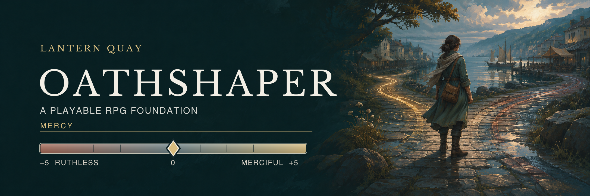

# Oathshaper



Oathshaper is a game engine in development for choice-driven 3D RPGs. Its MIT-licensed code combines a Godot host with a deterministic Rust story core. Developers can author and test dialogue rules, relationships, and consequences independently of 3D scenes. The Godot host presents those choices in a world players can explore. **Lantern Quay** is the included demonstration game.

The Rust core validates versioned JSON dialogue graphs, evaluates conditions, commits choice effects atomically, and loads versioned saves. Godot handles scenes, controls, camera, audio, UI, and the visible results of those choices. The oil subplot shows those layers together: choices change Mercy and Ivo's affinity, while donating oil to Mara can relight the quay early. Start with the [architecture](docs/architecture.md) or the [dialogue authoring guide](docs/authoring.md) to see how the two layers meet.

[Watch the Lantern Quay demo: three combat styles](https://www.youtube.com/watch?v=it2bQDUMk3k)

## Play the current slice

**The Quay Robbery** is a playable story: investigate the clerk's stolen payroll, recruit Mara and Ivo, confront the raider in the garden, and return the pouch. The launcher also lets you try three combat styles in that chapter:

| Style | What you control |
| --- | --- |
| **Command** | Switch companions, pause, and queue party actions. |
| **Flow** | Fight directly with four styles, Chi, and Focus. |
| **Vanguard** | Aim firearms and use shields, cover, and squad powers. |

Styles 04–09 are design previews, not playable combat modes. Oathshaper is an early engine: its integrated authoring editor and automated chapter generation remain proposed. The [release status](docs/release-status.md) records implemented scope and testing limits.

## Download the demo

[Download the Windows, macOS, or Linux demo](https://github.com/oathshaper/oathshaper/releases/tag/demo-2026-11-03). Extract the full archive before launching; Godot and Rust are only needed to build from source. The release page lists platform-specific test coverage and limits, and the [installation guide](docs/install.md) covers launch steps and controls.

## Run from source

Use **Godot 4.3.stable** and **Rust 1.95.0**. From the repository root, build the Rust extension, import the Godot project, and launch it:

```sh
sh scripts/build-host.sh
godot --headless --path godot --import
godot --path godot
```

Use your Godot 4.3 executable path if `godot` is not on `PATH`. Choose **The Quay Robbery** for the story or **Combat styles** to inspect the playable modes. See [detailed play and development notes](docs/play-and-development.md) for controls, screenshots, checks, and research context.

## Build on it

- [`oathshaper-core`](crates/oathshaper-core) is the Godot-independent narrative rules crate; [`oathshaper-godot`](crates/oathshaper-godot) is its GDExtension bridge.
- [Lantern Quay's JSON story](godot/content/lantern_quay.json) is a concrete authoring example. The [authoring guide](docs/authoring.md) covers stable IDs, conditions, effects, and validation.
- [Architecture](docs/architecture.md), [combat design](docs/combat-design/README.md), and [release status](docs/release-status.md) separate implemented behavior from proposals.

Oathshaper is a working name and an independent homage to companion-driven RPGs. The [attribution and third-party notices](THIRD-PARTY-NOTICES.md) carry the dedication, licensing terms, media provenance, and research-reference policy; the [project media license](ASSET-LICENSE.md) states its scope.
