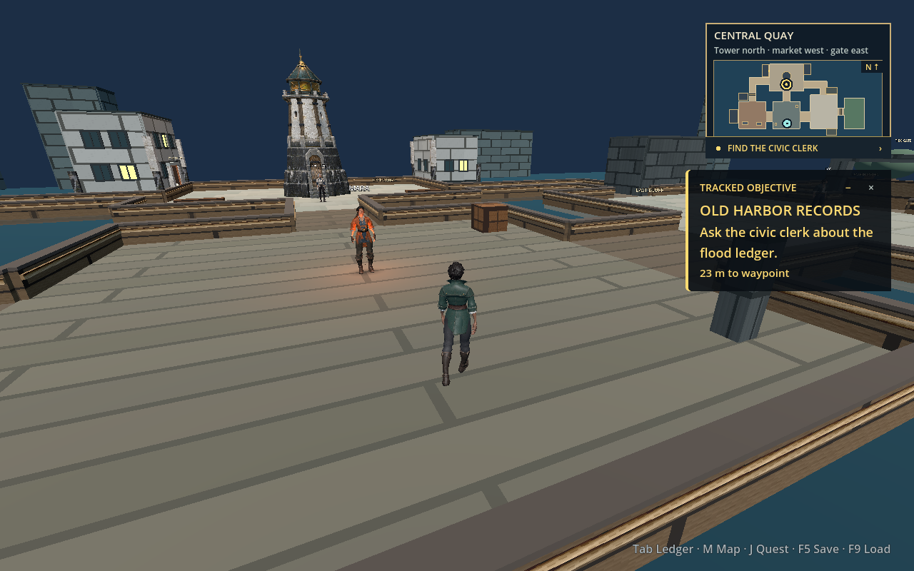
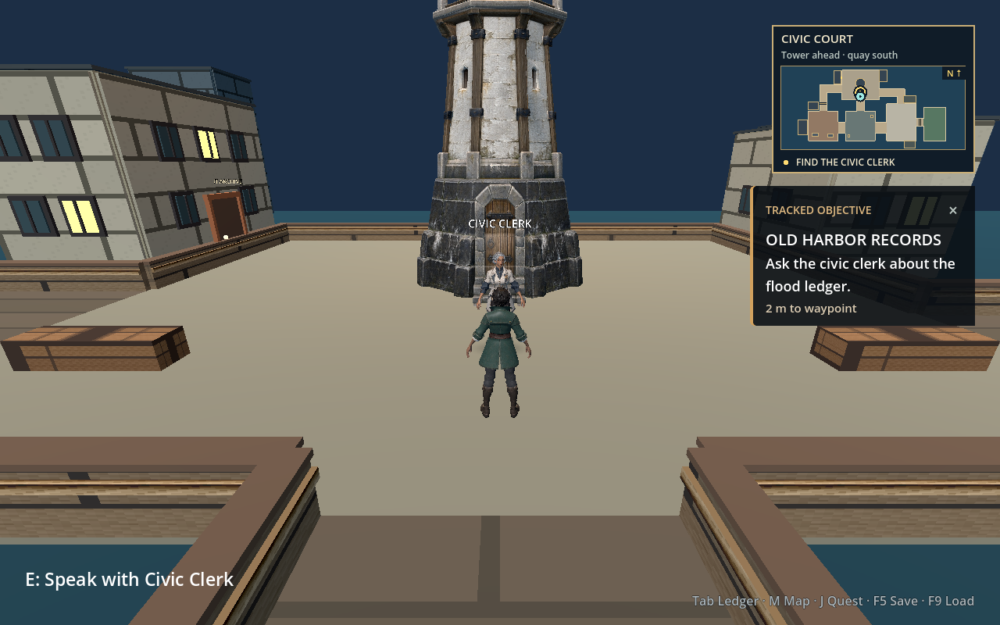
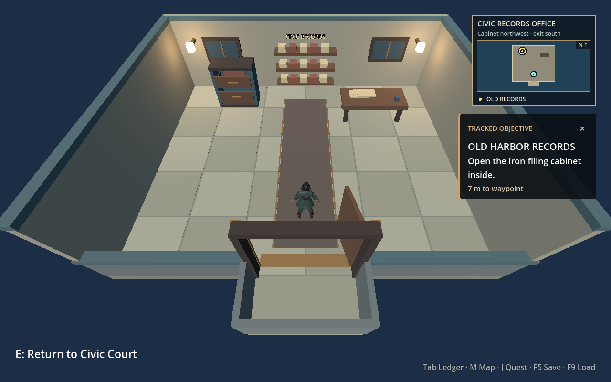

# Exploration camera

The early BioWare manuals show different balances between movement and camera control. The [Jade Empire: Special Edition PC manual](https://cdn.akamai.steamstatic.com/steam/apps/7110/manuals/Jade%20Empire%20manual%20revised.pdf) explicitly lists an adjustable delay before the camera follows the player in its Control settings. The [Knights of the Old Republic PC manual](https://cdn.cloudflare.steamstatic.com/steam/apps/32370/manuals/KOTORI_Manual.pdf) lists movement, camera rotation, and free look as separate controls. The [Mass Effect PC manual](https://eaassets-a.akamaihd.net/eahelp/manuals/mass-effect-manuals_PC_en_US.pdf) lists WASD movement and mouse look/aim. The latter two manuals do not specify a camera follow algorithm. Oathshaper's behavior is an interpretation for this prototype, not a claim to reproduce any game's internal camera code.

In [camera_rig.gd](../godot/scripts/camera_rig.gd), the exploration camera stays about `5 m` behind the player at a `20°` pitch and follows position without lag. During movement, yaw eases behind the character at an `18/s` response rather than snapping to every new heading. Keyboard A/D still turn toward lateral travel, but their speed is `70%` of forward speed after a `0.15 s` ramp and the actor turns at most `180°/s`. Forward W and directional left-stick steering keep their faster response. Backward input moves opposite the captured camera forward direction while the actor backpedals and the camera keeps its heading; releasing S or the left stick does not cause a delayed 180° turn. [player.gd](../godot/scripts/player.gd) captures the camera-relative movement basis for a continuous left-stick gesture. Sweeping the stick changes world direction smoothly in that basis, even while the camera turns; returning to neutral starts a fresh gesture. A WASD key edge deliberately samples the current camera view. When both devices are active, the last active device supplies the whole movement vector. This is Oathshaper's movement design, not a reconstruction of a commercial game's internal implementation.

Right mouse drag and right stick override the automatic turn. The chosen exploration heading persists until explicit recenter or a scene transition; an idle timer does not take it back. Manual orbit also turns the player toward the chosen view and updates the movement basis. Middle drag pans, holds for `1 s`, then gently returns to the player. F or right-stick click recenters both yaw and pan immediately. Mouse wheel zoom, pitch limits, and the separate dialogue shot remain available. A physics ray pulls the close camera toward the player when solid scenery is between the desired eye position and player focus, then lets it return gradually when clear. Entering the roofless records office resets the carried outdoor yaw and switches to a higher cutaway angle so the player and cabinet stay in frame. Leaving or loading a save explicitly resets the camera for the destination area.

## Manual combat view

Command and Flow hold the full camera pose after manual orbit or zoom while the controlled character is stationary. Target movement, selection changes, idle animation and elapsed time do not move that held view. Moving the controlled character translates the focus; Command can then adjust for obstructions within its existing per-frame search budget. When the character stops, the view holds again. Rotation remains under the player's control until recenter. A deliberate party switch frames the new controlled character and then holds there.

The first manual input starts from the visible camera pose, including any automatic obstruction adjustment, rather than an older saved orbit. While the player is dragging, collision checks can shorten camera distance, but automatic visibility searches do not choose a different angle. A player-selected shot can therefore leave a fighter behind foliage; recenter restores automatic framing.

`camera_hold_test.gd` checks these behaviors against actual Command and Flow stages. It runs in `scripts/check.sh` and the chapter continuity manifest. The camera obstruction samples in `playtest_continuity_test.gd` explicitly recenter before checking automatic recovery, so they do not require automatic framing to override a manual shot. See the [27 October camera hold verification](camera-hold-20261027/README.md).

The follow and return speeds, keyboard lateral speed, ramp and turn rate, manual orbit and pan grace, and occlusion return speed are exported for tuning. The [Godot headless scene test](../godot/tests/headless_test.gd) exercises held lateral travel, keyboard changes, W then S then W travel and camera heading, left-stick reverse, gradual analog sweeps, mixed-device priority, manual orbit and pan, tower occlusion, office framing, recentering, and dialogue framing. A twelve-frame D press on macOS now travels `0.42 m`, turns the actor `36°`, and turns the camera about `25°`; a further 24 frames travels `1.26 m` and brings the camera behind the completed turn without bending the path. Before the reverse fix, S moved backward `0.60 m` while the view yawed `169°` and the actor turned `173°` in eight frames, making reverse look like forward motion. The regression now requires opposite world travel and a steady heading, including after release. The original threshold mapping produced a `70°` one-frame world-heading jump during a `2°`-per-frame stick sweep; the continuous-gesture mapping produced a `2°` maximum frame turn in the same test. A rendered macOS desktop pass checks the 1280 × 800 presentation. This source split currently recognizes fixed physical WASD and left-stick axes from the project input map; a future control-rebinding feature must update that recognition. Physical controller feel and Steam Deck behavior still need a device playtest.

The [current windowed macOS D-turn capture](images/camera-keyboard-d-gentle-turn-1280x800.png) shows the camera partway through an A/D turn with the tower materials in place. At this rendered frame, D had been held for 11 observed physics ticks (about `0.22 s` wall time): the player had moved `0.37 m` east, the actor turned `33°`, and the camera turned `23°`. This screenshot samples a windowed run; the exact 12- and 36-physics-frame measurements above come from the headless test.

These earlier 1280 × 800 macOS captures illustrate the close chase and indoor cutaway framing:

| Close chase near the civic clerk | Records office cutaway on entry |
| --- | --- |
|  |  |
