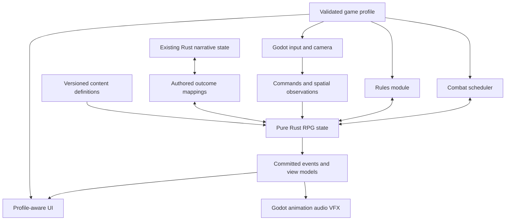

# Oathshaper combat foundation

**Shared-engine design revision · 2026-10-22:** the [LCD ADR](combat-design/lcd.md) and [profile design run](combat-design/README.md) define the new design pass. The ADR keeps identity/transaction/recovery invariants in the kernel and makes mechanical services optional; it resolves the earlier conflicting queue-reservation assumptions through explicit profile policy. Profile designs will be evaluated independently on branches from the reviewed LCD checkpoint.

**UX and archetype revision · 2026-10-22:** [Combat UX contracts](research/006-combat-ux-contracts.md) and [archetypes, equipment and inventory](research/007-archetypes-equipment-inventory.md) supersede the generic loadout examples below. The nine profiles now have 36 actor-specific build previews shared between Godot and the browser study. They are design data; combat and equipment transactions remain unimplemented. Proposed source-informed defaults distinguish ME1 weapon heat, Flow's style collection, PF2 Bulk and the three ATB policies. See the [research rights notice](research/NOTICE.md).

**ATB extension · 2026-10-22:** [Momentum, Confluence and Cadence](research/005-three-atb-profiles.md) now distinguish action-driven, live-field and classic menu ATB. They share future gauge/accounting primitives with explicit timing and command policies. Their presentation skins are in the nine-choice launcher; combat execution remains planned.

**Proposed design · 2026-10-21 · baseline `05aa7b6`**

**2026-10-22 update:** the [Godot front end](combat-front-end.md) now implements title/new/load, saved presentation skins, Ledger gear/ability previews and practice attacks. The combat systems below remain planned. **Oathbound** is a Dragon Age: Origins-inspired Command variant: four-person party, warrior/rogue/mage equipment roles, mana/stamina, cooldowns and ordered companion conditions. Its UI skin is available; its tactics evaluator is future Rust work. See [primary-manual research](research/002-bioware-controls-and-origins.md).

This is an implementation plan, not a record of working combat. The [prior-art report](research/001-combat-systems-prior-art.md) contains source evidence and limitations. The [interactive interface study](design/combat-profile-preview.html) demonstrates profile-aware menus with sample data; it does not run Godot or alter saves.

## 1. The experience to build

Choose a combat profile from the main menu, inspect the party and its equipment, then enter the **actual imported Lantern Garden**. Play a short encounter in that profile's native style. Return to the menu and try the same scenario in another profile. Characters, story identity, relationships, and recognizable geography remain consistent; controls, equipment, abilities, timing, and interface change together.

Default the initial selection to **Command**, matching the KOTOR request. Implement **Tactics** first because it provides the clearest rules oracle and the strongest reference prototype reuse opportunity. Neither choice limits future game authors to one ruleset or setting.

### Curated profiles

Names are original working labels. Numbers below are proposed demo settings, not claims about the reference games.

| Profile | Timing and control | Deployed party | Equipment and powers | Distinct interface |
| --- | --- | --- | --- | --- |
| **Command** — KOTOR-inspired | Live resolution; pause on contact; per-actor ordered queues; switch controlled actor | Player + 2 companions | Hands, armor, focus, accessories; trained powers and device grants | Party portraits, visible queues, targeting, auto-pause preferences, tactics page |
| **Flow** — Jade-inspired | Direct melee; lock-on; attack/guard/dodge; rapid style changes; optional tactical pause | Player + 1 follower | Martial/weapon/magic/support styles; amulet and charms; chi/focus resources | Style deck, combo cues, follower Attack/Support, readable threat tell |
| **Vanguard** — Mass Effect-inspired | Third-person aiming/shooting; cover; two companion orders; paused command wheel | Player + 2 companions | Firearms, ammo, armor, shield emitter, modules; tech and extraordinary powers | Reticle, shield/health layers, squad wheel, weapon/mod comparisons |
| **Tactics** — BG3-like interface, PF/SF2-style rules | d20 initiative; three actions; reactions; move/target previews; controllable whole party | Player + 3 companions | Hands/armor/accessories, ammunition, spell repertoire/preparation, feats | Initiative rail, action pips, reaction prompts, range/cover and roll breakdown |
| **Momentum** — action/ATB hybrid | Direct basic action builds a command gauge; slow-time command selection | Player + 2 companions | Weapons and sockets; ability loadout; command gauge plus ability-specific resources | Gauge segments, party switching, command menu, stagger state |
| **Orders** — simultaneous planning | Queue a short plan for each actor, commit, execute both teams for a proposed 3-second interval | Player + 3 companions | Tactical kit, gadgets, ammo, reserve orders | Plan timelines, uncertainty indicators, commit control, replay of last interval |

Flow and Vanguard use continuous time, but have materially different control and execution contracts. They can share a scheduler without sharing all animation or targeting code. Momentum and Orders are additional deliverables after the four requested profiles, not reasons to delay the first playable slice.

First-person shooting is a **Vanguard control variant**, with a distinct aim origin, camera collision, view model and animation acceptance gate. Isometric action, stamina/parry combat, tab targeting and automatic combat are future compositions of these capabilities. A massive online or competitive fighting system would need additional authority and latency design.

## 2. Architectural boundaries



Introduce a pure Rust `oathshaper-rpg` crate for actors, parties, inventory, abilities, effects, encounter state and scheduler contracts. Keep the current narrative crate focused. Add a separately reviewable `oathshaper-rules-d20` module/crate for tactical rules and optional licensed content packs. Extend the existing GDExtension with a thin `RpgBridge`; do not put combat calculations in GDScript.

Godot owns input context, locomotion presentation, camera, scene collision, animation, audio, UI, navigation integration and author tools. The Rust bridge exposes typed JSON envelopes initially, following the current pattern, with batched snapshots/events. Do not send one JSON message per projectile per render frame. Profile before replacing the bridge with custom binary bindings.

`GameProfile` is a manifest, not a subclass containing the entire game:

```json
{
  "schema": 1,
  "id": "oathshaper.command.v1",
  "rules": "oathshaper.adventure.v1",
  "scheduler": "realtime_queue.v1",
  "controls": "third_person_command.v1",
  "party_policy": "three_deployed_switchable.v1",
  "equipment_schema": "adventure_gear.v1",
  "ability_catalog": "garden.command.v1",
  "interface": "command_ledger.v1",
  "theme": "harbor_brass.v1",
  "encounter_variant": "garden.command.v1"
}
```

This is a proposed authoring shape, not a schema already accepted by the runtime. Validate compatible capabilities at load time: e.g. an aim-required ability needs an aim provider; a prepared spell needs a preparation resource; a reaction needs a trigger/window implementation. Report file + stable ID + field path + reason. Unknown IDs, incompatible versions and dependency cycles fail before play.

Allow a **theme-only** override without changing simulation. Main-menu **combat profile** changes select the complete supported bundle. Experimental combinations stay in author tooling until they pass the same tests as a curated profile.

## 3. Shared RPG model

| Domain | Core records and invariants |
| --- | --- |
| Identity | Stable `ActorId`, narrative identity, presentation reference; selection/control never changes who owns a relationship or item |
| Party | Recruited roster, deployed subset, leader, controlled actor, formation, AI policy; deployment is constrained by profile and encounter |
| Archetypes | Versioned progression definitions, prerequisites, trained skills, unlock grants and resource rules; roles are loadout/AI choices rather than fixed classes |
| Item definitions | Immutable kind, tags, base properties, equip requirements, stack policy, allowed modifications, icon/model references |
| Item instances | Unique ID, definition/version, owner/container, quantity, ammo, charges, modifications and optional durability; each instance has one owner |
| Equipment | Named slot bindings and reservations, two-hand/offhand constraints, weapon sets, active set, equipped grants; unequip revokes only its own grants |
| Inventory | Member bags, shared party stash, containers, pickups, currency, protected quest objects; split/merge/transfer/equip/loot are atomic transactions |
| Abilities | Definition + source grant + runtime activation; learned/trained, equipped, innate, consumable and temporary grants are distinct |
| Resources | Health, stamina, mana/chi, focus, shield, ammo, heat, charges, spell slots, action budget and ATB; regeneration and overflow are explicit policy |
| Effects | Typed changes with source, target, stacking key/policy, resistance and immunity checks, duration, dispel categories and expiration triggers |
| Defenses | Ordered layers, damage types, penetration, reduction, cover, saves, guard/poise; visible explanation of which layer absorbed an impact |
| World skills | Dialogue, stealth, perception, medicine, lock/tool use and investigation call shared skill checks with domain-specific consequences |
| Encounter | Participants, teams, goals, join/leave rules, reinforcements, hazards, surrender/flee, downed/revive/death policy, completion and reward receipts |
| Social state | Story moral axes, companion affinity and faction reputation are separate; combat reports outcomes through authored mappings |

Do not implement the entire table's content library at once. The first slice needs one stackable consumable, one protected quest item, a weapon swap, two-handed validation, a mod-granted ability, a learned power, and a companion transfer. These expose the ownership bugs early.

### Abilities: common contract, meaningful differences

An `AbilityDefinition` contains:

- **Origin and acquisition:** martial, magic, tech, innate, divine or other author-defined tags; source item/archetype/training and prerequisites.
- **Targeting:** self, actor, point, direction, area, chain or ground shape; faction/range/LOS/height filters; target acquisition and revalidation policy.
- **Delivery:** contact arc, projectile, hitscan, beam, aura, placed zone or direct rules check. Origin is independent of delivery.
- **Costs:** action count, resource pool, ammo, charge, cooldown group, preparation slot; reservation and consumption stage.
- **Execution:** startup, contact window, recovery, channel ticks, cancel/interrupt windows, movement restrictions, combo links.
- **Resolution:** rule-module calculation IDs, effects, defense interaction and tags such as EMP-sensitive or interruptible.
- **Presentation:** animation/cue IDs, cast indicator, sound/VFX and subtitle/accessibility cues; missing assets have visible safe fallbacks.

One family can express a concussive spell, a shock device and a shield bash, but each recipe retains its counters, timing, resource economics and acquisition. Share effect operators, not a universal damage formula. PF/SF spells and action activities remain rules-module definitions; ordinary action-mode cooldowns are not mechanically faithful substitutes.

Example garden abilities: **Brace** (guard/protection), **Gust** (control), **Arc pulse** (shield disruption), **Field dressing** (support), **Lunge** (mobility/contact), **Yield** (encounter interaction). Original names/content; no borrowed character powers or descriptions.

### Party agency

Define tactical presets such as Protector, Support, Skirmisher, Marksman and Controller. Each is an ordered list of bounded conditions and allowed actions. Player-issued orders take precedence; AI may cancel them only for a declared reason such as incapacitation or lost target. Show that reason in the queue/order view.

For Flow, one follower can switch between Attack and Support. A support follower remains a visible deployed actor with a specified location/vulnerability policy; the initial demo uses damageable followers with a nonlethal downed state. Only the player is directly controlled in that profile. Other profiles declare whether companions are directly switchable or order-only. Summons use an explicit owner and separate capacity/lifetime rules.

The demo roster can use the existing player, Mara and Ivo, plus the civic clerk as an **explicit training guest** for four-person modes. This is fixture configuration, not a permanent claim that the clerk has joined the campaign. The vendor remains a vendor; adding gear UI does not silently recruit every NPC.

## 4. Action execution and time

```text
Intent -> preview -> validate/reserve -> start -> impact(s) -> recover -> finish
                          |               |         |
                          +-- reject      +-- cancel/interrupt --> refund policy
```

`CommandEnvelope` carries command ID, actor, expected state revision, selected ability/item, target, and simulation time. The result is accepted with an action ID or rejected with a typed reason. Duplicate IDs cannot duplicate expenditure or rewards. A stale preview never authorizes execution.

- Preview is read-only and consumes no random numbers. It explains costs, known defenses and uncertainty without revealing hidden enemy state.
- Queue entries are intentions; reserve costs when an action becomes ready, not for an arbitrary future queue. At activation, atomically validate and reserve. Commit each cost at its declared stage. Cancel before start refunds unspent reservations; interrupted committed costs follow the ability's documented rule.
- Each permitted impact is keyed by `(action_id, impact_index, target_id)`. Prevent duplicate area hits and repeat animation notifications from double-applying effects.
- Target loss has a declared outcome: fail/refund, hold, or reacquire within a specified filter. Never silently charge a failed order and pick a different ally.
- Reactions have explicit triggers, priority, once-per-trigger limits and bounded nesting. Pause safely for a player reaction; nested menu/dialogue/reaction pauses release only their own token.
- Victory, defeat, surrender, escape and simultaneous elimination are explicit encounter resolutions. An empty queue or temporarily absent enemy is not victory.

Use integer ticks and rational slow-time factors, with separate wall/UI/audio time. Duration types include `SimTicks`, `OwnerTurnEnds`, `RoundEnds`, `UntilEvent`, and `NarrativeTime`. Movement and turn budgets are distinct. No universal conversion of “two turns” into seconds. Menu pause stops encounter clocks while UI remains responsive; combat profile switching is disabled inside an active encounter.

### Scheduler contracts

Each scheduler provides `submit`, `advance`, `ready_actors`, `decision_windows`, `snapshot` and `restore`. The shared action executor handles legality/effects; the scheduler controls when actions advance.

- **Command:** per-actor queues; configurable automatic basic attack/hold/defend when empty; auto-pause on contact, controlled actor idle, incapacitation or selected event. User orders always remain inspectable.
- **Flow/Vanguard:** continuous fixed-tick action lifecycle, input buffering and cancel windows. Hit timing, input latency and camera behavior need visual/controller acceptance, not just unit tests.
- **Tactics:** initiative, stable tie-breakers, three-action budget, reactions and end-turn effects; grid/path cost from a rules-owned spatial model. A PF/SF pack must implement its specified exceptions rather than reducing all activities to one action.
- **Momentum:** continuous basics plus per-actor gauge; slow-time planning still advances simulation at the configured rate. Reserve/spend gauge once, even if the menu submits the same command twice.
- **Orders:** both teams commit plans before execution; AI cannot inspect unrevealed player orders. Preview is a forecast of known information. Conflicting movement uses a deterministic resolution policy with a visible blocked outcome.

### Determinism boundary

The first action profiles use Godot locomotion and collision. Record canonical spatial observations—actor poses, visibility/cover and accepted contacts—alongside commands. Rust replay guarantees identical rules outcomes for the same initial state, content versions, random streams, commands **and observations**. It does not claim identical Godot physics from raw WASD input across machines. [Godot's documented limitation](https://docs.godotengine.org/en/stable/tutorials/physics/physics_introduction.html) motivates this boundary.

Tactical grid movement can be fully rules-owned. Specify and version a portable PRNG algorithm, serialize its stream state, use stable iteration order and integer/fixed-point rules quantities, and test replay hashes on macOS and Linux. If input-only action replays become a requirement, implement a deterministic spatial simulator as a separate workstream; do not hide that cost inside a fixed-timestep setting.

## 5. Party sheet and profile-aware menus

The sheet should open from the same **Menu/Tab** action in every profile. Roster portraits run along the top. The selected character's large portrait/avatar occupies the left column, **morality directly beneath it**, and relationship information immediately below. Center/right columns contain profile-specific stats, abilities and equipment. A cosmetic theme changes colors and motifs; the profile changes actual information and interaction.

| Common location | Command | Flow | Vanguard | Tactics | Momentum | Orders |
| --- | --- | --- | --- | --- | --- | --- |
| Character | Attributes, powers | Training, chi/focus | Specialization, shields | Abilities, saves, proficiencies | Role, command gauge | Role, readiness |
| Equipment | Hands, armor, focus | Styles, amulet, charms | Weapons, armor, emitter, modules | Hands, armor, accessories, ammo | Weapon, sockets | Kit, gadgets |
| Abilities | Powers, queue defaults | Style deck, combos | Powers, shared cooldown rules | Repertoire/preparation, action costs | Commands and gauge costs | Orders and execution time |
| Party | Formation and tactics | Active follower and mode | Squad power assignments | Deployment, control, reactions | Switching and AI | Plans and reserve orders |
| Inventory | Shared categories with profile-specific comparisons and allowed actions across every profile |
| Journal / Map / Load / Save | Stable placement and behavior across every profile |

Morality belongs to the selected actor's known story state. The first fixture shows player Mercy `-5..+5`; for a companion without an authored moral axis, show **Outlook unknown**, not the player's Mercy falsely relabeled as theirs. Show that companion's relationship to the player separately. Future multiple axes appear as a short stack of labeled meters, including independent scales where authored. Morality, affinity and faction reputation never silently become one score.

Profile selection previews supported controls, deployed party size, equipment and pacing. Saving includes the profile name and icon so load slots are understandable. Disabled actions explain requirements with an icon and concise reason; obsolete narrative choices disappear under the existing dialogue policy.

Controller requirements: consistent confirm/back, bumpers for roster, triggers for pages, D-pad for rows, a visible focus path, context-sensitive glyphs, and no essential hover interaction. Input-context priority is modal dialog → menu → targeting → combat → exploration. Changing devices must preserve selection and avoid accepting the same button twice. Aim/lock-on, camera follow, sensitivity and inversion are per-control-profile settings. Text labels accompany colors; support remapping, hold/toggle alternatives, reduced shake and slowdown assistance.

The browser study is a visual/interaction proposal only. It uses existing concept portraits and the actual garden screenshot, sample attributes and sample inventory. It must never be presented as footage of working combat.

## 6. Saves, switching and narrative consequences

Keep a common campaign record (identity, story flags, morality, affinity and quest receipts) plus a profile-specific build/loadout record. `ProfileSave` contains equipment instances, learned/prepared abilities, resource state, content version and rules version. `EncounterSnapshot` adds scheduler state, queues, reactions, pending costs, cooldowns/effects, random streams, spatial snapshot, and the applied event watermark.

**Main-menu switch flow:** select profile → show its party/loadout preview → apply → start that profile's garden trial or resume its compatible checkpoint. Preserve the current profile's save before changing. Demo gear is issued from that profile's fixture; do not reinterpret a sword instance as a rifle or convert spell slots to ammo. Campaign consequences remain common. Show when a saved active encounter belongs to another profile and offer to resume that profile or start a separate trial. Never overwrite it silently.

Use atomic save replacement and explicit migrations from current narrative/hub save revision 4. Preserve old saves during conversion. Unknown future versions, missing content packs and unsupported migrations produce an actionable message. Test save/load at planning, startup, impact, recovery, reaction and completion boundaries. If a first release restricts saving to checkpoints, disclose and enforce that restriction; do not serialize a partial encounter and call it supported.

Combat sends committed domain outcomes such as `encounter_resolved`, `actor_spared`, or `civilian_harmed`. An authored mapping validates and atomically applies the appropriate narrative effects, with an outcome ID stored in a durable receipt set. One encounter outcome must not grant Mercy or loot twice after a retry/load. Replayable drills are sandboxed; they cannot farm story morality or companion affinity.

## 7. The garden encounter

Use the imported mesh as the visual authority. Current terrace bounds are X `36..50`, Z `-8..4`; the bridge is X `30..36`, Z `-4..0`. The raised terrace and four planters create short lanes. The current source includes fitted walking/bed/rail collision but no combat navigation, cover metadata or target volumes. [Current map and provenance](hub-map.md).

### Layout work

1. Author a `GardenCombatLayout` resource with spawn anchors, routes, cover segments, exclusion volumes and camera-safe zones. Derive tactical cells and minimap overlays from the same coordinates.
2. Treat stone planter walls as cover where measured height supports it; tree canopies are not automatically bulletproof. Give each obstruction explicit movement, sight and projectile masks.
3. Validate 0.42 m player capsule clearance on the bridge and between planters, then formation passage and two-way traffic. Use compact initial waves and staged reinforcement. For four-person modes, place the guest/support actor near the entrance instead of stacking four actors in a narrow lane.
4. If measured playable lanes cannot support the encounter, extend the adjoining approach with a small authored staging apron and update the map/collision together. Preserve the actual garden art and layout; do not replace it with procedural trees or flatten it to a generic arena.
5. Annotate simplified geometry for targeting/navigation. Do not generate combat collision from the approximately 900k visual triangles. Profile the actual mesh with the intended actors and effects before accepting a Deck target.

### Scenario: The disputed charter

At the garden entrance, a watch representative asks for help retrieving a seized harbor charter. The player can negotiate before hostility, choose a nonlethal confrontation, or start the encounter. Two opponents occupy different lanes; a third arrives after a clear warning. One carries a protected/shielded defense that can be disrupted, one threatens a companion, and a control effect opens an opportunity for coordinated action.

At a defined surrender threshold, the encounter enters a safe parley window. **Accept surrender** and **Press the attack** produce different committed outcomes. A subsequent conversation with Ivo references that decision. Only the first canonical resolution applies campaign changes. The main menu's **Garden trials** replay the same encounter in isolated profile fixtures; the menu labels these as practice and restores the canonical campaign afterward.

Add clear retreat and party-down outcomes. An active fight pauses relevant story interactions; return to exploration restores the prior camera and input context. Existing records quests and garden gate state must survive the combat flow.

### What the player proves in each trial

| Profile | Short playable proof | Observable success |
| --- | --- | --- |
| Command | Pause on contact; queue Brace for a companion, Gust for another, then Lunge; reorder/cancel once and resume | All actor queues execute as shown; invalidated target gives a reason; queue empty policy is visible |
| Flow | Lock target, guard a telegraphed strike, dodge, switch from support to martial style, use follower Support | Responsive contact windows, readable combo opportunity, meaningful chi/focus costs |
| Vanguard | Aim from cover, strip a shield, order a companion power, reload, advance | Reticle and muzzle obstruction agree; defense layers and ammo change correctly; squad order is acknowledged |
| Tactics | Spend three actions on move/skill/strike; preview a second attack; trigger a reaction and end turn | Costs/penalties are explained, initiative advances, reaction resolves once, occupied tiles remain blocked |
| Momentum | Build gauge through action, slow time, select a companion command, spend one segment | Gauge and simulation time behave consistently; action remains playable without opening menus |
| Orders | Plot a flank and covering action, commit both teams, watch a blocked path resolve, inspect replay | Hidden enemy orders stay hidden until resolution; plan and actual result are distinguishable |

Target each trial at roughly 2–4 minutes after the shared introduction. This is a design target, to be measured in playtests. Use profile-specific enemy tuning, ranges, durations and recipes; do not force identical DPS or action counts across fundamentally different modes.

### Art and feel requirements

The present Idle/Walk/Talk rigs are insufficient for action combat. Build an animation capability manifest per actor: locomotion blending, turn/strafe/backpedal, guard, at least two attacks, cast/device use, aim/fire/reload, hit/stagger, downed and recovery. Weapon sockets and contact/aim markers must align with the models. Use shared retargetable clips only after testing coat/shoulder deformation and foot contact. Avoid adding permanent bowleg correction transforms on top of an already corrected pose.

Camera profiles must preserve forward/reverse behavior and current close follow. Action lock-on changes movement interpretation explicitly. Shooter aim rotates actor toward aim; tactical targeting releases the exploration camera. Test walls, tree canopy, bridge rails, dialogue transitions and companion switching. Camera shake/impact pauses are presentation effects and must not corrupt simulation clocks.

## 8. reference prototype reuse worklist

Read-only reference: `the private reference checkout (not distributed)`, commit `778159cee98bb07a3e7dd70e8f01b9190a18bbaf`. No copying is authorized by a presumed open-source license; inspect ownership/license before actual reuse. Keep the existing project untouched.

| Adapt after provenance review | Rewrite for Oathshaper | Exclude by default |
| --- | --- | --- |
| Selection/targeting state machine in `combat_input.gd`; pure outcome preview approach; grid/path/cover concepts; GUT scenario and seeded invariant strategies | Rules in pure Rust; versioned PRNG; typed commands/events; item ownership; scheduler interfaces; actor/party identities; save migration; controller UI | Existing characters, art, setting, named abilities, sourcebook text and unreviewed PF/SF data |
| Initiative/action/condition algorithms as candidate references | Explicit victory/surrender/simultaneous defeat, complete execution validation, reactions, reproducible snapshots | Any assumption that passing reference tests demonstrates Oathshaper behavior |

Every actual adapted file must record source path, commit, license, changes and destination in the reuse audit. Port selected tests as behavioral expectations, then add Oathshaper-specific adversarial cases. A rules pack being “PF/SF-style” must not be marketed as fully compatible until conformance and source obligations are satisfied. The initial original adventure rules can ship independently of that pack.

## 9. Delivery sequence and acceptance

### Milestone A — Shared RPG state and the tactical garden

Build party/inventory/equipment/abilities, transactional commands, saves/migrations, common sheet, profile manifest validation, garden layout, and Tactics. Pin a small named tactical rules subset with a provenance/conformance ledger. Keep other profiles visibly unavailable until playable.

**Exit:** equip/transfer/use/loot round trip; four actors take valid turns; preview is nonmutating; reaction and surrender affect later dialogue once; save/load restores exact next outcome; keyboard/controller route reaches every page. This is the first playable combat slice.

### Milestone B — Command and direct action

Add Command queues and companion policies, then Flow and Vanguard with their dedicated animation/control passes. Deliver first-person Vanguard only after its own aim/camera tests. Keep per-profile encounter recipes and comparison UI concrete.

**Exit:** the four requested styles each complete the garden trial from the main menu. Switching profiles updates all relevant menus and retains the campaign. A controller playtest confirms movement/aim/lock-on/order selection feels usable; automated tests alone cannot pass this gate.

### Milestone C — Additional timing models and release evidence

Add Momentum and Orders to exercise the remaining scheduler boundaries. Finish mode-specific tutorials, accessibility, content authoring examples, portable replay tests, performance work and physical Deck acceptance.

**Exit:** all six trials are playable, saves/replays survive every supported boundary, and evidence names the OS/hardware/input device used. No “Deck verified” claim based solely on a Linux container or a 1280×800 screenshot.

### Required evidence matrix

| Layer | Meaningful checks |
| --- | --- |
| Rust model | Ownership conservation; no item duplication/loss; equip grant/revoke symmetry; quantities/costs bounded; atomic failures |
| Rules/scheduler | Preview does not advance RNG; duplicate commands/impacts idempotent; cancel/refund; target death midcast; nested reactions; paused status expiry; concurrent defeat |
| Save/replay | Restore at each supported action phase; same next event and final hash; profile mismatch; old-save migration; missing packs; completion retry cannot duplicate rewards |
| Cross-platform | Same Rust command/observation replay hashes on macOS and Linux; record PRNG/content versions; distinguish this from Godot physics parity |
| Godot headless | Profile manifests resolve; adapters/capabilities valid; menu focus and back stack; inventory/party view models; scene navigation/cover anchors; narrative outcome application |
| Rendered desktop | Actual six profile entry flows, readable 1280×800 menus and tooltips, moving contacts, cover aim, camera recovery, party management and save/load |
| Physical controller | Explore → fight → tactical wheel → party sheet → transfer item → return → surrender → save/load, without keyboard or mouse; device switch preserves focus |
| Performance | Proposed 40 fps target on Deck at 1280×800, 25 ms frame budget; measure p95 frame time and spikes with full party/effects; profile before setting final quality level |
| Regression | Existing branching dialogue, morality/affinity, records route, gate/minimap alignment, W/S and A/D behavior, garden traversal, NPC poses |

No combat checks in this matrix have been run yet. This research pass validates source evidence and the interface study only. Multiplayer, full tabletop rules coverage, crafting economies and a large encounter campaign remain outside this delivery sequence.

## 10. Decisions to carry into implementation

1. Share persistent actor/item/effect contracts; give each scheduler and rules pack explicit authority.
2. Treat profile selection as a supported mechanical bundle with a matching UI, and theme as a separate cosmetic setting.
3. Keep story identity/morality common and profile builds separate; sandbox replayable trials.
4. Make the imported garden the layout authority, then author navigation/cover around it.
5. Start with Tactics as the rules oracle, deliver the four requested styles before the two additional styles, and require controller/animation evidence for direct action.
6. Keep code/content provenance, deterministic replay guarantees and hardware verification boundaries visible in the acceptance record.
