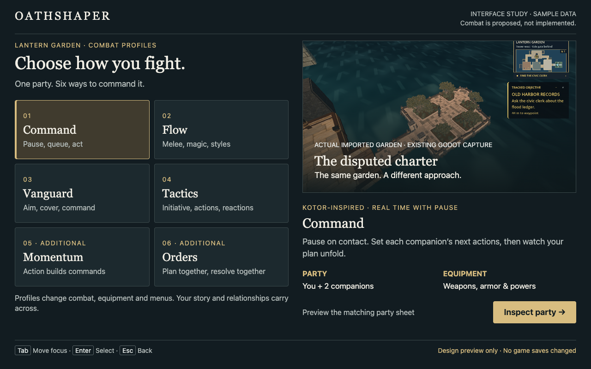
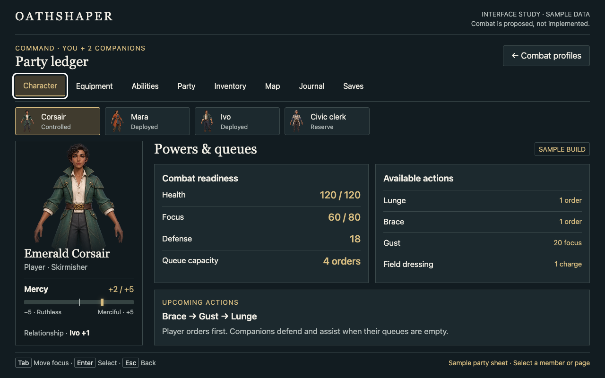
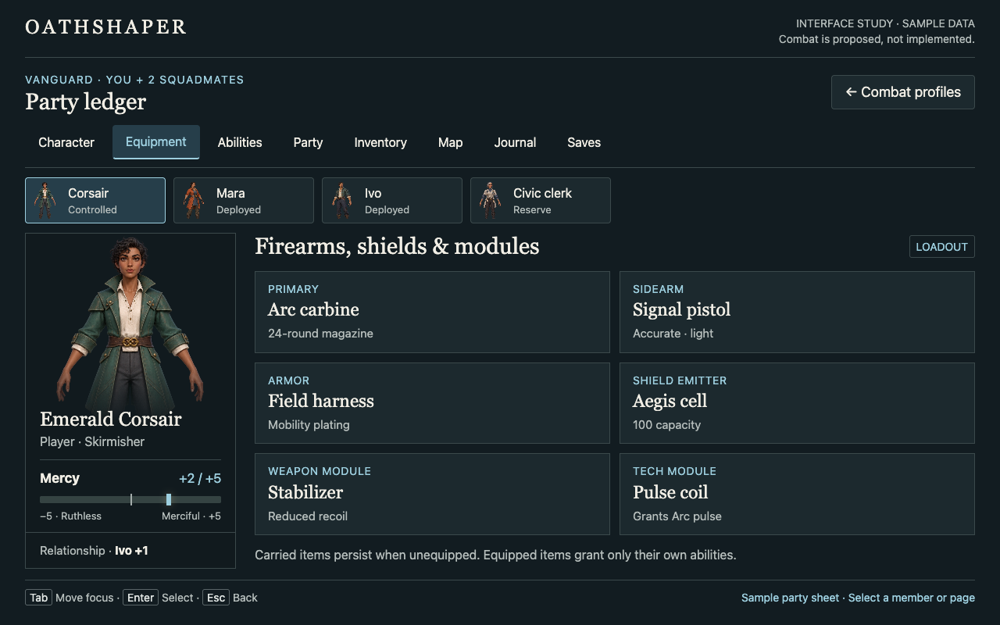

# Combat interface study

Open [combat-profile-preview.html](combat-profile-preview.html) in a desktop browser. It loads only local files and requires no server, package install, network service, or game process.

1. Select one of nine profiles, including Oathbound, Momentum, Confluence and Cadence.
2. Choose **Inspect party**. Select a roster member and visit the Character, Equipment, Abilities, Party, Inventory, Map, Journal and Saves pages.
3. Inspect Mercy directly below the player portrait. Companions without authored morality show **Outlook unknown**; Ivo's affinity remains separate.
4. Use **Combat profiles** or Escape to go back and compare another mode.
5. On Saves, bookmark the preview selection, change profile, then restore it. This only changes in-memory browser sample state; it cannot read or write game saves.

This is a proposed interface with illustrative builds. All four actors have authored builds in every profile: 36 distinct previews, sourced from the same catalog as the Godot Ledger. Each includes resources, training, gear, actions, source/cost, tradeoffs and progression. These are proposed builds, not functioning combat. Controller support is specified in the [plan](../combat-foundation-plan.md) but not implemented in this browser mockup. Keyboard Tab/Enter/Escape and pointer navigation work.

## Current verification — 2026-10-22

`tools/verify_party_preview.cjs` checks 144 actor/page states across all nine profiles, actor roles and rendered gear/actions, horizontal bounds, nine bookmark/back flows and JavaScript errors. It runs against the local file with installed Chrome and Playwright. Long detail panes scroll independently; navigation and the research notice remain visible at 1280×800. `python3 tools/export_party_catalog.py --check` verifies the generated browser data matches the Godot catalog.

## Provenance

Read the [research and third-party rights notice](../research/NOTICE.md). This is independent comparative research, with no affiliation or endorsement. The notice does not establish fair use or grant asset rights.

The HTML/CSS/JavaScript is original interface-study code. Portraits reference the existing generated [character concepts](../../art/concepts/README.md). The garden illustration references the existing actual Godot capture of the imported mesh; it is not a rendering of implemented combat. No new third-party art, reference-game UI, reference prototype source, or dependencies were copied. The underlying Meshy garden's redistribution status remains as documented in [asset provenance](../../godot/assets/meshes/README.md).

## Historical verification — 2026-10-21

Browser checks use installed Chrome through an already-cached Playwright package on **macOS**, at **1280×800**. This is interface-study verification only:

- Six profile selections and eight pages per profile: 48 rendered page states with content.
- Profile-specific equipment and ability content; selected companion does not inherit the player's morality.
- Back/Escape returns to profile selection; preview bookmark restores its profile selection.
- No browser JavaScript errors in the navigation pass.
- Desktop screenshots inspected for readability, portrait/meter placement, and profile differences.
- An initial 63 px page overflow was found and the layout tightened before final captures. The final 48 page states had no page overflow at 1280×800.

No Rust, Godot, Linux runtime, physical controller or Steam Deck combat checks were run: this change is research, planning and a local HTML preview. The game and reference prototype were not modified.

## Captures

Current actor-specific capture: [Mara's Vanguard kit](../images/combat-archetype-study-1280x800.png). Earlier captures below are retained as historical design evidence.
