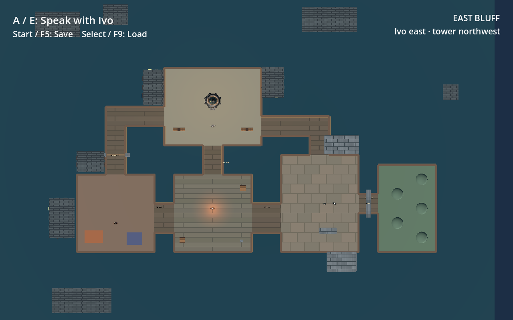
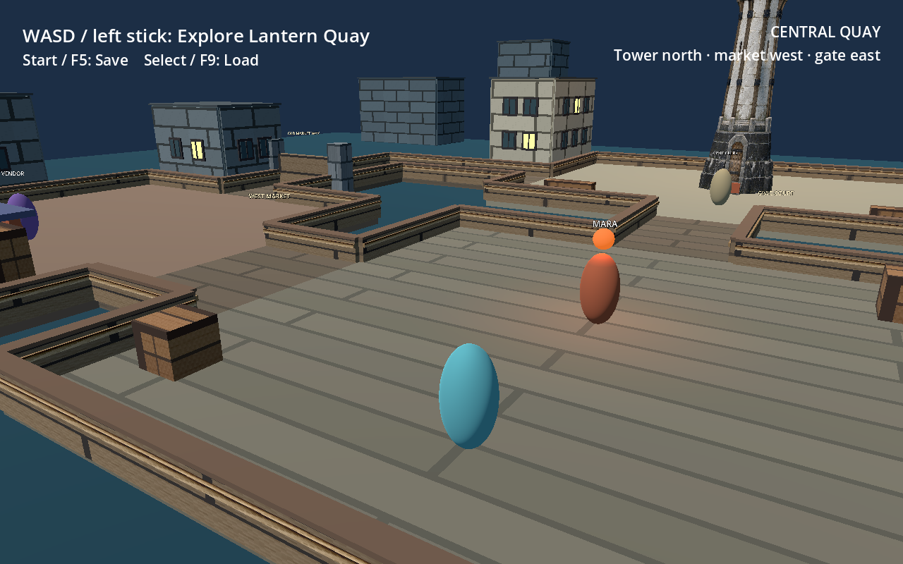
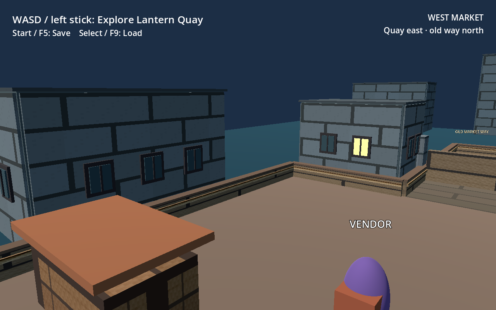
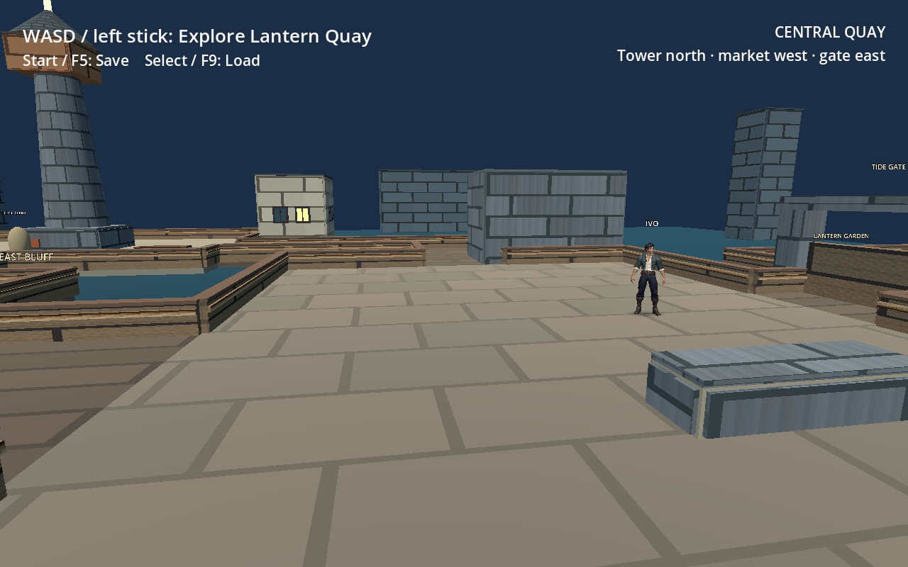
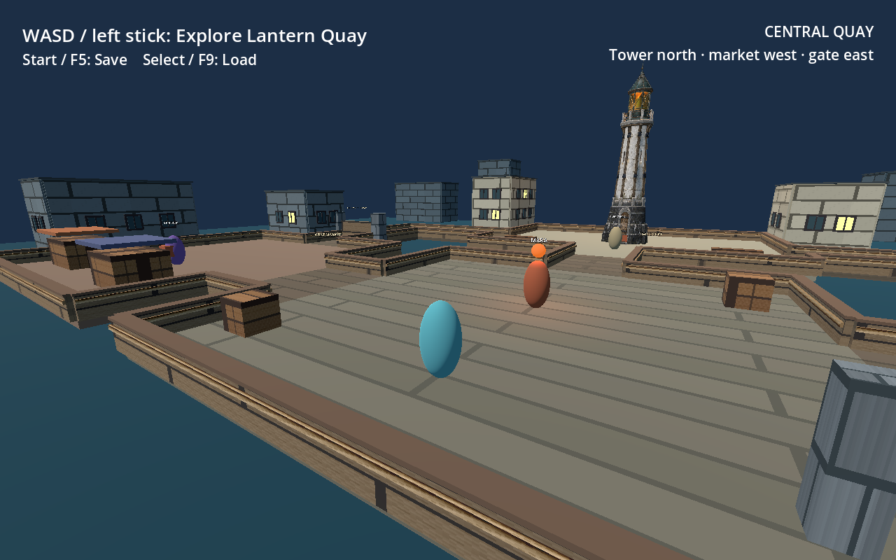
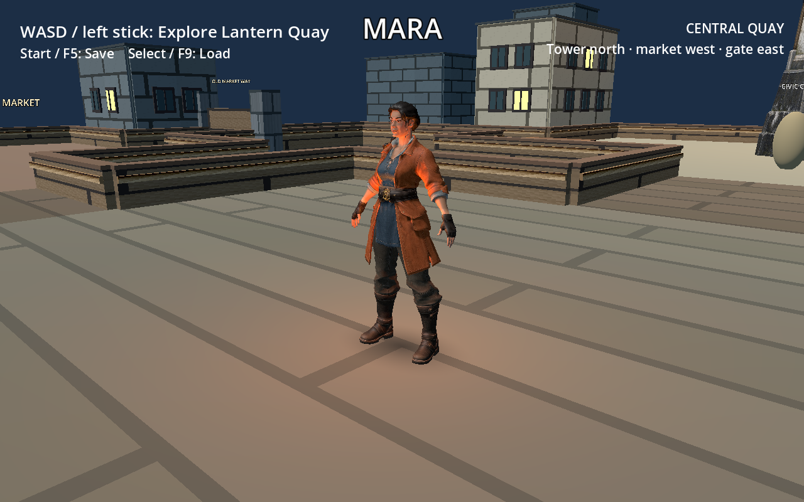
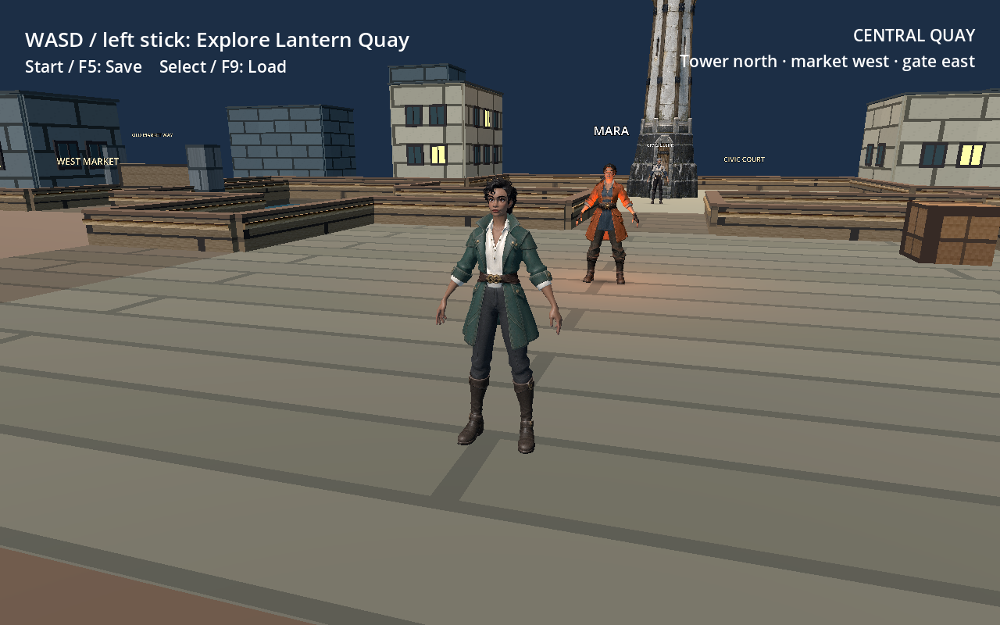
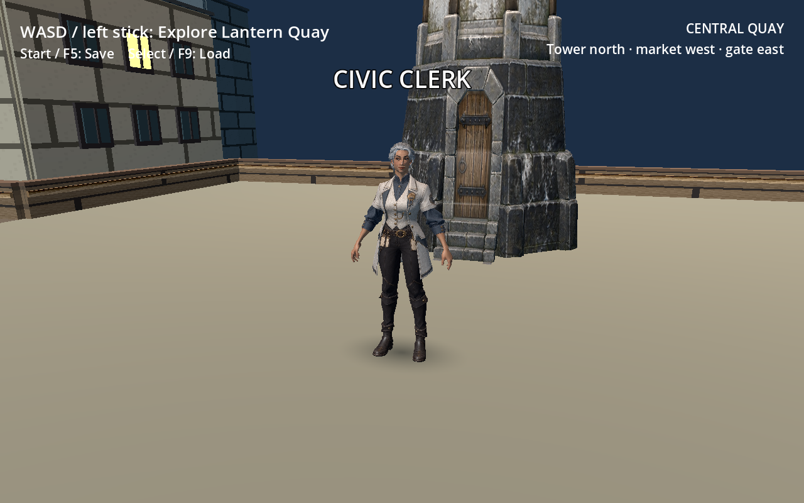
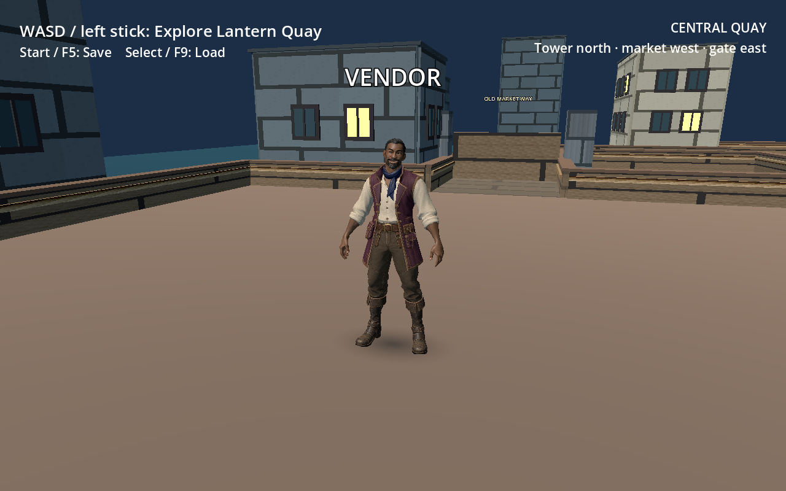

# Lantern Quay hub expansion

The quay is a small bounded district built to test the feel of an early party RPG hub: a tower visible from several approaches, two walkable loops, a route that opens through a conversation, and a garden visible before the tide gate opens. Seawalls, buildings, water, and distant roof silhouettes make the playable edge legible. The [blockout map](hub-map.md) records coordinates, collision, and the tower replacement contract.

The [quay approach](images/hub-overview.png), [open east gate](images/hub-east-gate-open.png), [textured Ivo close view](images/hub-ivo-imported.png), [Embercoat Mara view](images/hub-mara-imported.png), [Emerald Corsair player](images/hub-player-emerald-corsair.png), [Ironclad Matriarch clerk](images/hub-civic-clerk-ironclad-matriarch.png), and [Harbor Merchant vendor](images/hub-vendor-harbor-merchant.png) were captured from graphical Godot 4.3 runs on macOS at 1280×800. The overhead view is a debug camera capture; it is not the new in-game map. These captures predate the records route and journal.

The district uses repeating dock boards, bluff paving, masonry, timber pier faces, rope strips, crates, rock, and roof tiles. Near buildings have textured skins and windows on all four sides; distant buildings and the gate use textured primitive geometry. The tower uses an imported textured GLB. The images below are unedited Godot captures.

## Walkthrough

1. Start on the central quay. Speak to Mara: the camera frames her face above a letterboxed, controller-ready dialogue panel. Share the oil; her later greeting and lamp change. Ask where Ivo stands watch once and that choice remains visible but greyed as completed. Use Leave on a leaf line, or back out, to restore the exploration camera.
2. Walk north to the tower and civic clerk. Ask about the old harbor records. The objective tracker moves from the clerk to the west archive door, and the compact map marks it. The clerk's separate records-passage choice opens the short market–court route if Mara's oil has been shared.
3. Enter the signed west archive door beside the tower. The map switches to the records office and points to the iron filing cabinet. Interact with the cabinet, open the drawer, and take the Old Harbor Records. The objective completes and the folio appears under Inventory in the journal. Use the office door to return to the court.
4. Walk east to Ivo. Sharing oil gave Mercy `+2` and Ivo affinity `+1`, satisfying his gate choice. Ask him to unbar the tide gate, then cross the rising stone bridge into the imported lantern garden.
5. Visit the west market vendor for directions and a line that responds to the opened routes. Use Tab or controller Start/Menu for the journal, including its Map, Load, and Save pages. Use M or controller Back/View for the expanded map; F5 and F9 remain keyboard quick save and load.

The journal also has Character, Equipment, and Inventory pages. Character shows Mercy and Ivo affinity. Equipment has empty display slots; no equipment rules are implemented. The compact and expanded maps show player position, the current records waypoint, and open or closed routes. The objective tracker shows the next records step and a rounded distance; active text and the minimap quest row are yellow, and completed ones turn green. Its −/+ control collapses or expands the panel, and × dismisses it. Clicking the minimap quest row restores the expanded tracker. The office map focuses on the cabinet. These controls and the records interactions are described from the current source; see the validation boundary below for what has been exercised.

The current 1280 × 800 graphical captures show the [active tracker](images/oathshaper-quest-active.png), [collapsed tracker](images/oathshaper-quest-collapsed.png), [green completed tracker](images/oathshaper-quest-complete.png), and [Mara's rigged dialogue pose with the completed Ivo question](images/dialogue-mara-repeat-rigged-1280x800.png).

The dock, paving, masonry, timber, rope, rock, slate, and canvas surfaces use [generated albedo maps](../godot/assets/textures/materials/README.md) in place of the former 64 px tiles. The signed archive door, roofless office, cabinet, drawer, and record bundle retain original Godot geometry, now covered by mapped surfaces where appropriate. The map and journal remain Godot code. No reference prototype textures or imported archive model were used. The player, clerk, and vendor use skinned derivatives of their owner-supplied textured Meshy exports; the originals and primitive art remain fallbacks. The [character and tower concept images](../art/concepts/README.md) remain separate image-to-3D references. The [four-view Market Bridge dock package](../art/meshy/dock/README.md) shows one existing 4 × 6 m segment from complementary angles for a possible Meshy reconstruction; no dock GLB is imported.

The garden now displays an [optimized Seaside Garden GLB derivative](../godot/assets/meshes/README.md#seaside-garden) in place of the scene-built trees, beds, lawn, and paths. The raw owner export remains outside the repository and untouched. The existing tide gate controls access; a scene-owned terrace collider and convex ramp let the player walk up the imported bridge's roughly `0.34 m` rise. The minimap and collision footprint were fitted to the model's X `36..50`, Z `−8..4` terrace and X `30..36`, Z `−4..0` approach. The [bridge approach](images/garden-imported-approach-1280x800.png), [interior path](images/garden-imported-interior-1280x800.png), [overhead view](images/garden-imported-overview-1280x800.png), and [expanded map](images/garden-imported-expanded-map-1280x800.png) are actual macOS Godot 4.3 captures at 1280 × 800. Generated foliage, bark, grass, and path maps remain for the blockout fallback if the GLB fails to load. The [source audit and optimization notes](meshy-environment-reference.md#located-meshy-exports) distinguish this imported garden from the still-unimported Harborlight Haven and Market Bridge concepts.

The player, Mara, Ivo, clerk, vendor, and tower use user-supplied [textured Meshy GLBs](../godot/assets/meshes/README.md) with embedded 2048 × 2048 maps. Their exact prompts, inputs, licenses, and redistribution rights remain unverified; the project's MIT code license covers code and does not establish rights to distribute these GLBs. The five original character GLBs are static; Blender-derived GLBs for all five characters contain weighted skins and clips.

Character GLB slots load 3D scene imports from `godot/assets/meshes/` and hide matching primitive visuals. The normal slot convention is feet at local Y `0`, offset by `-1 m` from a parent at standing height. The character exports are centered meshes about `0.95` model units tall; their scene slots scale them by `2` with a local `+0.10 m` offset. A floor ray aligns the four stationary NPC meshes and scene-owned colliders at runtime, with a small contact shadow. Mara, Ivo, the clerk, and the vendor play skeletal `Idle` and `Talk`. The player plays skeletal `Idle` and an in-place `Walk`, with reverse playback while backpedaling; the slot rotates its visual by 180° to face forward travel. Mara's belt lantern uses a scene-owned light; her primitive lamp globe is hidden while her model is present. Collision, interaction, labels, and dialogue stay scene-owned. The [rigging guide](rigging.md) explains the asset contract and reproducible Blender build. The tower slot replaces visible primitive art with the supplied normalized Meshy beacon model, using scene-configurable scale and offset while preserving the footprint collider and beacon light. Animation polish and performance tuning remain future work.

## Story and scene contract

| Authored change | Rust condition/effect | Godot presentation |
| --- | --- | --- |
| Share oil with Mara | Set `oil_shared`; Mercy `+2`; Ivo affinity `+1` | Mara's later line and lamp change |
| Open records passage with clerk | Require `oil_shared`; set `shortcut_open` | Market–court barrier becomes invisible and non-colliding |
| Ask clerk about the old harbor records | Set `records_clue` | Objective and map move to the west archive door |
| Take records from the filing cabinet | Set `records_collected` once | Drawer bundle disappears; Inventory shows the folio; objective completes |
| Unbar tide gate with Ivo | Require `oil_shared`, Mercy `≥2`, Ivo affinity `≥1`; set `gate_open` | East garden barrier becomes invisible and non-colliding |

The content is story revision 4. The hub writes to `user://oathshaper_hub_v4.save.json`, leaving revision-3 saves at their old path. The Rust save contains story state and the Godot world envelope stores player position. Earlier narrative revisions are incompatible without an explicit migration; none is implemented here. No combat or dynamic dialogue generator is part of this expansion.

## Validation boundary

After the Seaside Garden import on 2026-10-21, `GODOT_BIN=/Applications/Godot.app/Contents/MacOS/Godot sh scripts/check.sh` exited 0 on macOS arm64: Rust formatting and strict Clippy, 20 Rust tests, dialogue validation, the host GDExtension build, Godot import, and seven headless Godot scripts including the new garden traversal check. `sh scripts/check-linux.sh` exited 0 in Linux x86-64 Docker: a release ELF extension build, SHA-256 check of the pinned Godot 4.3 archive, asset import, dialogue validation, and the same seven scripts. The garden check drives the real player forward and backward over the raised bridge, checks terrace rise and descent, and verifies planter and rail collision. The map test compares four displayed bed footprints with their scene colliders. Actual 1280 × 800 macOS Godot [approach](images/garden-imported-approach-1280x800.png), [interior](images/garden-imported-interior-1280x800.png), [overhead](images/garden-imported-overview-1280x800.png), and [expanded map](images/garden-imported-expanded-map-1280x800.png) captures were visually reviewed after the final map and horizon fixes. Headless Godot still prints the dummy-renderer null-mesh diagnostic despite zero exit codes. The Linux run is a desktop container check; physical Steam Deck performance and controller hardware remain untested.

Before the Seaside Garden GLB import, on 2026-10-21 after the material, pier, blockout garden, office, and player-gait pass, `GODOT_BIN=/Applications/Godot.app/Contents/MacOS/Godot sh scripts/check.sh` exited 0 on macOS arm64. It ran Rust format and strict Clippy, 20 narrative tests, revision-4 dialogue validation, a host GDExtension build, Godot import, and the six headless Godot scripts for scene/controller simulation, rig slot, map, office, and records route. `sh scripts/check-linux.sh` exited 0 in Linux x86-64 Docker, built the release ELF extension, verified the pinned Godot 4.3 archive, imported assets, and passed the same Godot checks. `python3 scripts/verify-rigged-glbs.py` verified all five weighted character skins and clips. A 25-frame Blender gait check and actual 1280 × 800 macOS Godot [before](images/rig-player-walk-before-frame-07-1280x800.png) and [after](images/rig-player-walk-after-frame-07-1280x800.png) frames were inspected. The [quay](images/material-pass-quay-1280x800.png), [court](images/material-pass-court-1280x800.png), [market](images/material-pass-market-1280x800.png), [blockout garden](images/material-pass-garden-1280x800.png), [waterline](images/material-pass-seawall-1280x800.png), and [office](images/material-pass-office-1280x800.png) renders are graphical macOS Godot 4.3 Compatibility captures, not Linux screenshots. The earlier blockout garden entry and two path spurs also passed local physics ray checks without blockers. Godot headless still emits its known dummy-renderer `mesh_get_surface_count: Parameter "m" is null` diagnostic despite the zero exit codes. Texture seams and physical Steam Deck performance remain unmeasured; no physical controller test was run in this pass.

On 2026-10-20, after the A/D turn, player stride, and tower paint-match pass, `python3 scripts/verify-rigged-glbs.py` verified all five weighted skins and required clips. `python3 scripts/extract_tower_textures.py` reproduced the three Stonewatch JPEG payloads byte for byte from the SHA-256-pinned owner GLB. `GODOT_BIN=/Applications/Godot.app/Contents/MacOS/Godot ./scripts/check.sh` exited 0 on macOS arm64 with 20 Rust narrative tests, strict Clippy, dialogue validation, the host extension build, Godot import, and all six headless scripts. `./scripts/check-linux.sh` exited 0 in Linux x86-64 Docker, built an ELF extension, and passed its Godot import and headless checks. The movement test measured a 12-frame D press at `0.42 m` of lateral travel, `36°` of actor turn, and about `25°` of camera turn; W/S reverse and analog steering regressions also passed. Actual 1280 × 800 macOS Godot captures show the [revised walk](images/rig-player-walk-camera-follow-1280x800.png), [court](images/tower-paint-match-court-1280x800.png), and [archive](images/tower-paint-match-archive-1280x800.png). Godot's pre-existing dummy-renderer null-mesh diagnostic appeared in headless runs despite zero exit codes. A physical controller and Steam Deck remain untested.

On 2026-10-20, after the player, clerk, vendor, and Ivo pose pass, `python3 scripts/verify-rigged-glbs.py` verified all five weighted character skins and their required nonconstant clips. The original and derived GLBs retained byte-identical embedded JPEG payloads. `GODOT_BIN=/Applications/Godot.app/Contents/MacOS/Godot ./scripts/check.sh` exited 0 on macOS arm64, including 20 Rust narrative tests, dialogue validation, a host GDExtension build, Godot import, and all six Godot headless scripts. `./scripts/check-linux.sh` exited 0 in a Linux x86-64 Docker container, built an ELF release extension, and passed its Godot import and headless scripts. A graphical 1280 × 800 macOS Godot 4.3 inspection captured each NPC's Idle and Talk states and a player Idle → Walk → Idle sequence driven by a simulated joypad event; the actor moved 1.65 m and the camera followed 1.65 m. This is a desktop check, not a physical Steam Deck or controller test. Small trim flecks and close coat/hand overlap remain for an art pass.

On 2026-10-20, after the dialogue-repeat, reverse camera, Mara pose, and quest tracker pass, `GODOT_BIN=/Applications/Godot.app/Contents/MacOS/Godot ./scripts/check.sh` exited 0 on macOS arm64. It passed Rust formatting and strict Clippy, 20 narrative tests, revision-4 validation of 16 nodes, a host extension build, Godot import, and the dialogue, scene, rig slot, map, records office, and route headless scripts. `./scripts/check-linux.sh` also exited 0 in a Linux x86-64 Docker container, building the release ELF extension and passing the same Godot scripts. A physical Steam Deck and controller were not tested. Headless Godot continued to emit the known dummy-renderer null-mesh diagnostic despite zero exit codes. A graphical macOS Godot 4.3 run at 1280 × 800 showed Mara's corrected standing pose, the disabled Ivo repeat and Leave choice, and yellow active and green completed trackers. A separate graphical input check delivered a real viewport mouse click to the minimap quest row and observed the dismissed tracker reopen expanded. The scene headless test measured W travel at `−0.60 m` and S travel at `+0.60 m` in the same view, with actor and camera heading held at `0°` during reverse.

Earlier on 2026-10-20, after the close-camera, accurate-map, and tower-proportion pass, `GODOT_BIN=/Applications/Godot.app/Contents/MacOS/Godot ./scripts/check.sh` exited 0 on macOS arm64. It passed Rust format and strict Clippy, 18 narrative tests, revision-3 validation of 16 nodes, the host GDExtension build, Godot import, the separate Godot dialogue validator, and five Godot test scripts: hub scene, rig slot, map widget, records office, and route integration. `sh scripts/check-linux.sh` also exited 0 in a Linux x86-64 Docker container, building a release ELF extension and passing Godot import, the dialogue validator, and the same five test scripts. The route test covers the locked archive door, clerk clue, simulated controller map and journal actions, cabinet pickup, closed drawer state, obsolete choice removal, and save/load. The map test compares all 13 floor rectangles and 10 obstacle footprints against the generated scene. The scene test covers keyboard and simulated stick turns, a gradual analog sweep, mixed input, manual orbit and pan, tower occlusion, office entry/exit framing, and recentering. A `2°`-per-frame stick sweep now changes world heading by at most `2°` per frame; the previous threshold implementation jumped `70°` in one frame. Both hosts' headless Godot logs still print the pre-existing `Parameter "m" is null` dummy-renderer diagnostic although all checks exit 0.

A graphical Godot 4.3 macOS OpenGL walkthrough captured the compact and expanded maps, corrected tower, records office entry, cabinet dialogue, completed objective, and collected folio in Inventory at 1280 × 800. The six [records route gallery](hub-map.md#records-route-and-map) images were refreshed after the final code and asset changes. The [camera capture pair](camera-follow.md) shows the close outdoor chase and readable indoor cutaway; a held-side capture shows the camera turning behind the character while travel stays straight. The tower was compared from the same camera depth as the clerk before and after door-height correction. The Linux result covers headless Docker execution only. Physical controller behavior and Steam Deck operation remain untested. The older dated runs below cover previous hub, character import, and rig states.

On 2026-10-19, before the textured Ivo export, `GODOT_BIN=/Applications/Godot.app/Contents/MacOS/Godot sh scripts/check.sh` passed on macOS arm64: Rust formatting and strict Clippy, 15 core integration tests, revision-2 validation (13 nodes), host GDExtension build, Godot asset import and story validation, and the scene test. The scene test covered simulated controller input for all four NPCs, locked and unlocked choices, barrier collision, missing voice, save/load, and replacement of Ivo's primitive body by the first untextured Meshy GLB. A graphical Godot 4.3 run confirmed runtime reconstruction of that export's missing normals. The first source GLB remained byte-identical to the user export.

The 2026-10-19 `sh scripts/check-linux.sh` run passed for the first untextured Ivo import in a Linux x86-64 Docker container: release GDExtension build, pinned Godot 4.3 archive hash check, asset import, story validation, and the same headless scene test. A fresh temporary copy of the Godot project also imported Ivo and passed the scene test without an existing import cache. In separate temporary copies, a node-only GLB with no mesh left Mara's and the tower's primitive fallbacks visible; a temporary copy of Ivo's visible mesh at the tower path hid the primitive tower while retaining its footprint. These swap checks do not establish skinning, animation, or performance for future exports. Godot's dummy renderer prints `mesh_get_surface_count: Parameter "m" is null` during headless scene runs on both hosts although the scene test exits 0; the graphical macOS capture did not show this error. These checks do not establish physical controller behavior or Steam Deck performance. Results for the original M1 scene are recorded separately in [the M1 evidence ledger](milestone-1.md).

On 2026-10-20, before the textured replacement and timber seawall pass, the full macOS check passed again, including 15 Rust integration tests, dialogue validation, Godot import, and the expanded scene test for Ivo's floor contact and foot-stable idle. Linux x86-64 Godot import and the expanded headless scene test also passed using the release extension built earlier that day; Rust extension code did not change in that pass. A physical Steam Deck test remains open.

For the textured Ivo, Stonewatch Beacon tower, and full surface pass before Mara's import, `scripts/check.sh` passed on macOS arm64: Rust format and strict Clippy, 15 narrative tests, dialogue validation, host GDExtension build, Godot import, and the headless scene test. The scene test checked Ivo's effective base-color texture and grounding, plus the tower's effective texture, floor alignment, visual bounds, footprint collider, and beacon light. Graphical Godot 4.3 OpenGL/Metal runs produced the earlier 1280 × 800 hub captures above and were visually inspected. `scripts/check-linux.sh` passed in a Linux x86-64 container, building the release extension, verifying the pinned Godot 4.3 archive, importing assets, validating dialogue, and running the same headless scene test. Godot's dummy renderer still prints `mesh_get_surface_count: Parameter "m" is null` during headless checks, although the commands exit 0 and the graphical macOS runs do not show it. These checks establish a desktop macOS render and Linux container import/runtime check; they do not establish physical controller or Steam Deck performance.

For the 2026-10-20 Embercoat Mara and rig-slot pass, `scripts/check.sh` passed on macOS arm64: Rust format and strict Clippy, 15 narrative integration tests, revision-2 dialogue validation, host GDExtension build, Godot import, the hub scene test, and the new synthetic `Idle`/`Walk`/fallback slot test. `scripts/check-linux.sh` passed in a Linux x86-64 Docker container: release GDExtension build, SHA-256 verification of the pinned Godot 4.3 archive, Godot import, dialogue validation, and the same two scene tests. The headless scene test checks Mara's imported texture, primitive replacement, lamp presentation, floor contact, and foot-stable idle. A graphical Godot 4.3 OpenGL/Metal capture on macOS produced the refreshed 1280 × 800 hub images and was visually inspected. The four measured dock renders were captured graphically at 2048 × 2048. Headless Godot still prints `mesh_get_surface_count: Parameter "m" is null` while all checks exit 0; the graphical capture did not show it. The rig-slot test proves clip selection with synthetic nodes, not skin weights or walking quality for a real Meshy model. No physical Steam Deck or controller hardware test was run in this pass.

For the later 2026-10-20 Emerald Corsair, Ironclad Matriarch, and Harbor Merchant import, both full scripts passed again. The macOS arm64 run included Rust format and strict Clippy, 15 narrative tests, dialogue validation, host extension build, Godot import, the scene test, and the expanded rig-slot test. The Linux x86-64 Docker run built the release extension, verified the pinned Godot archive, imported the three new assets, validated dialogue, and passed both Godot tests. The scene test checks all three models' visible textured imports and floor contact; the rig-slot test checks velocity-driven procedural motion, its central foot anchor, `Idle`/`Walk` clip selection with a synthetic skeleton, and fallback behavior. The refreshed 1280 × 800 overview and three character close views were captured graphically on macOS and visually inspected. Headless Godot continued to print its dummy-renderer null-mesh diagnostic while commands exited 0; the graphical runs did not show it. No physical Steam Deck, controller hardware, or articulated walking-rig test was run.
