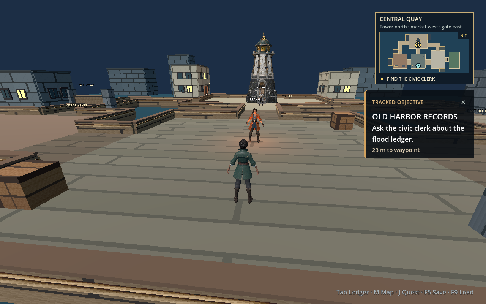
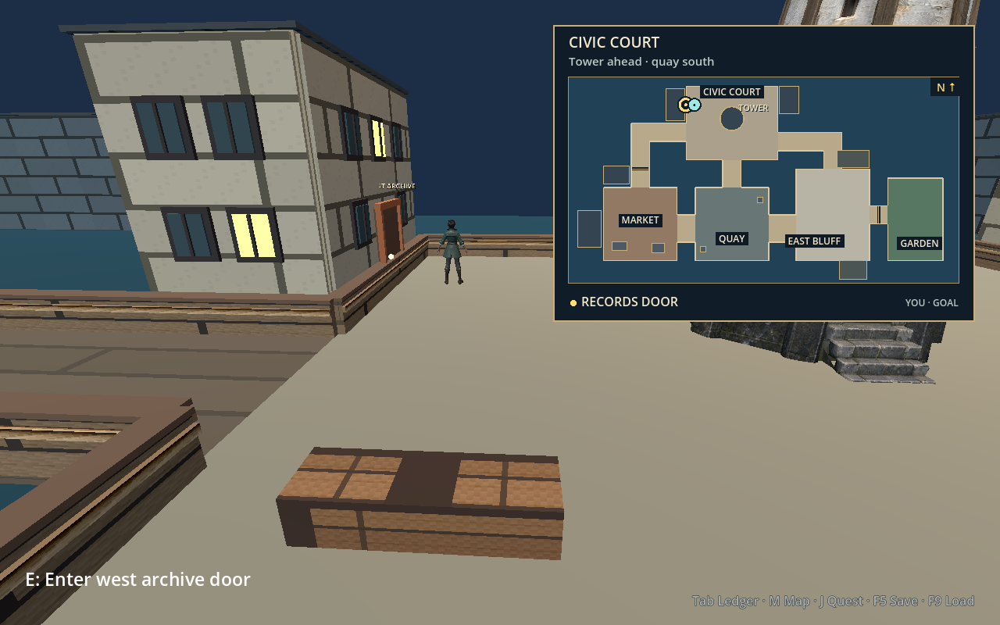
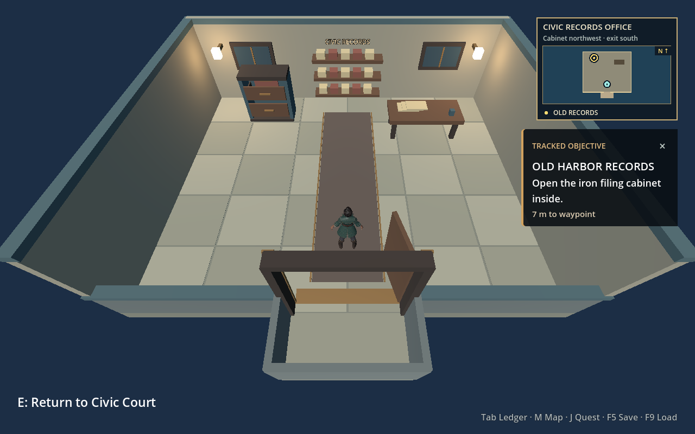
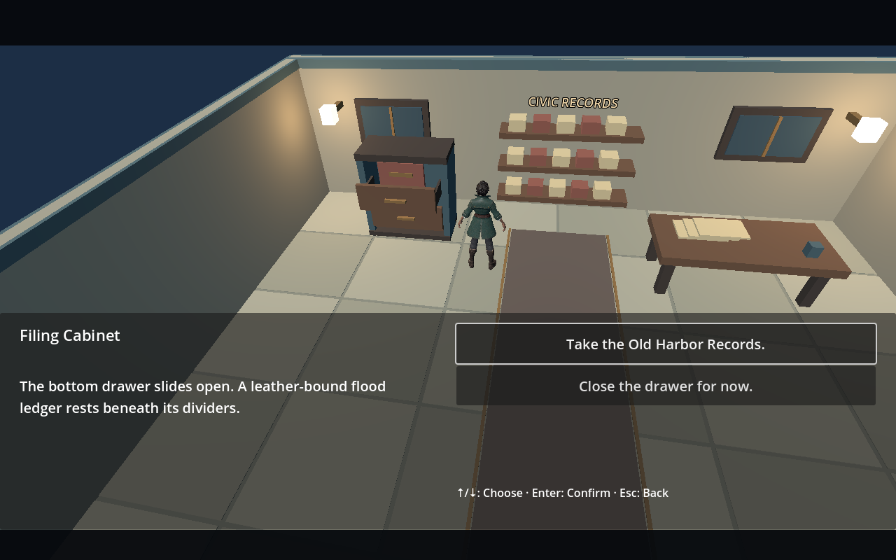
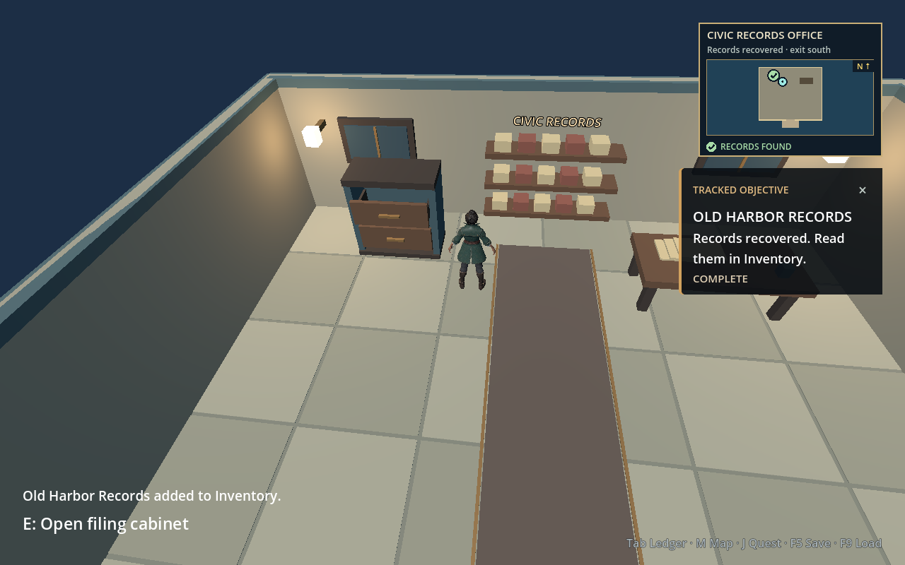
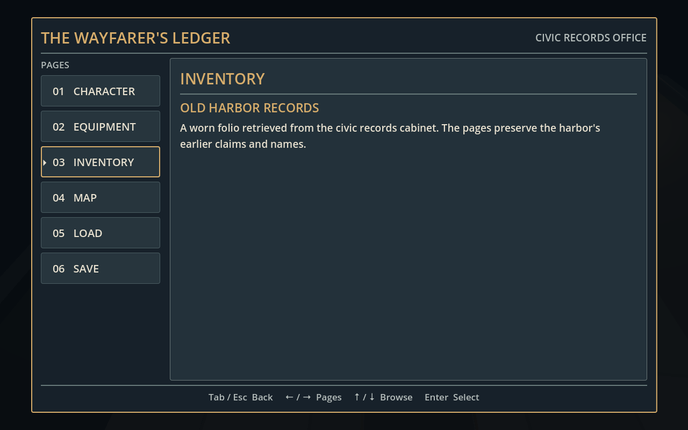

# Lantern Quay district blockout

The district's routes and collision are generated by `godot/scripts/hub_environment.gd`; the landmark tower and garden use imported GLB visuals. Coordinates use metres, with east at +X and north at -Z. It enlarges the first scene without moving the player at `(0, 1, 5)` or Mara at `(0, 1, -1)`.

The district plan is north-up: west market is left of the central quay, civic court and its tower are north, and east bluff and the gated garden are to the right. Thirteen coarse floor rectangles define the five districts and eight connecting paths; the imported garden uses its own fitted walking surfaces. The market–court alley is closed until the clerk opens it; the tide gate closes the short bluff–garden causeway. The in-game map draws the quay floor rectangles, actual building footprints, and a fitted garden polygon so route widths and bends match the playable space.

The market–court alley and east garden gate start closed. The Rust narrative flags are `shortcut_open` and `gate_open`. Godot passes those values to `set_shortcut_open(bool)` and `set_gate_open(bool)`. Both leave their arch posts in place when open. The garden remains visible across the gate before it opens. `is_shortcut_open()` and `is_gate_open()` expose the current presentation state; Rust narrative state and the save file remain authoritative.

| Area | Approximate bounds (X, Z) | Visual cue |
| --- | --- | --- |
| Central quay | `[-8,8] × [-8,8]` | Open timber pier and Mara's lamp |
| West market | `[-28,-12] × [-8,8]` | Low ochre and indigo stalls, roofline |
| Civic court | `[-10,10] × [-30,-14]` | 10.6 m lantern tower; signed west archive door near `(-10.1, -26)` |
| East bluff | `[14,30] × [-12,8]` | Lookout terrace and rocky backdrop |
| Lantern garden | coarse bounds `[38,62] × [-14,6]` | Imported stone terrace, planters, trees, and railings beyond the gate |
| Garden causeway | `[30,39.7] × [-4,0]` | Imported bridge joins the tide gate to the raised terrace |

The two-metre floor grid creates a low seawall where a walkable region ends, with a 2.4 m opening at the signed archive door. Colliders back the seawall wings, district furniture, both barriers, and the imported tower's full-height column. The water, skyline blocks, and mounted archive sign remain visual only. Floating world-space district and gateway labels were removed; the minimap and objective tracker provide directions. Paths join edge to edge, so the walls do not cut across a junction. The market–court and quay–court paths form the first loop when the alley opens; quay–court–bluff forms a second loop from the start. Views of distant roof silhouettes imply streets beyond the playable district.

## Records route and map

The civic clerk stands near the tower. Asking about the old harbor records sets `records_clue` in the Rust story and points the objective at the signed door on the west archive's east facade. The exterior building remains a solid facade; interacting with the door transfers the player to a separate, roofless records office. The room occupies world X `154..166` and Z `-29..-19`, with its entrance near `(160, -21)` and the iron filing cabinet near `(156.8, -27.5)`. The return door leads back to the court. Taking the records sets `records_collected`; the cabinet's visible bundle and the journal Inventory page reflect that flag. The clerk's market–court shortcut is a separate choice with its own `shortcut_open` condition.

`map_widget.gd` draws a compact `260 × 190` exploration map or an expanded `540 × 380` map. Its 13 floor rectangles, orthogonal connections, archive buildings, market stalls, bluff rocks, tower, records door, and two barriers are placed in world X/Z coordinates with equal scale on both axes. A Godot regression test compares all 13 floor footprints and key landmark positions with the generated scene. The header names the current district and gives a short direction cue. M or controller Back/View toggles the expanded view; Esc or controller east/B collapses it. Both are north-up: east is right and north is up. The map shows the player, the current waypoint, and the shortcut and tide-gate state. An edge arrow indicates that the player has left the mapped bounds. Inside the office the map switches to the room plan and cabinet marker, which becomes a checkmark when records are collected. The objective tracker names the next stop and displays rounded metres to the waypoint. Its × button, J, or controller north/Y dismisses it; J/Y restores it, and a new stage brings it back. Godot draws these views from the position and Rust-owned flags; the maps do not own quest progress. See the [hub walkthrough](hub-expansion.md#walkthrough) for the player path.

These Godot 4.3 macOS OpenGL captures show the route at 1280 × 800:

The [expanded geometry-aligned map](images/records-route-expanded-map-1280x800.png) shows the district and route widths from the current generated floor layout. The [shortened civic tower](images/civic-tower-shortened-1280x800.png) shows the full landmark beside the clerk at the same camera position used to compare the older proportions.

| Starting compact map and clerk objective | Expanded map at the west archive |
| --- | --- |
|  |  |
| Records office and cabinet waypoint | Open cabinet dialogue |
|  |  |
| Objective complete and drawer closed | Inventory after pickup |
|  |  |

## Surface art and provenance

The [environment map set](../godot/assets/textures/materials/README.md) replaces the old in-code dock/paver tiles and five 64 px placeholder images. The 4 m dock and paving repeats show weathered planks and pale limestone setts. A front-on seawall map puts pale ashlar above a dark wet course, with a separate rock-textured skirt down to the waterline. Non-colliding timber posts, low stringers, rope wraps, and caps recur along the exposed runs, while the archive threshold stays clear. Slate, timber, rock, and canvas maps cover the authored dock and building surfaces. Market and civic facades retain their meshed windows and tower-matched stone shader. The imported [Seaside Garden derivative](../godot/assets/meshes/README.md#seaside-garden) supplies the garden paving, planters, trees, and railings with its embedded material; generated foliage, bark, grass, and path maps remain for the garden blockout fallback.

The supplied garden is **70% larger** than its initial placement (uniform GLB scale `15.64`). [`GardenLayout`](../godot/scripts/garden_layout.gd) aligns the bridge by `4.5°` and anchors its mouth at world X `32`, Z `−2`. The four-metre outer footprint contains a 3.36 m clear plank deck and stone sill between the side walls. The sill covers the mesh's irregular edge; fitted side beams terminate against its first posts. No plank corners protrude beside the stone bridge. The bridge stays level until the gate pillars; the rise to the terrace is approximately `0.58 m`. Simple fitted deck, ramp, terrace, planter and rail colliders follow that geometry; the dense imported triangles remain visual only. The old coarse garden collision slabs are disabled. The minimap draws the enlarged terrace and beds using the same transform, within expanded map bounds. The generated fallback is also enlarged if the GLB is unavailable.

Compare the actual macOS Godot [approach](images/garden-imported-approach-1280x800.png), [oblique join](images/garden-fitted-join-1280x800.png), [return view](images/garden-fitted-return-1280x800.png), [overhead view](images/garden-imported-overview-1280x800.png), and [expanded map](images/garden-imported-expanded-map-1280x800.png). The [walking clip](images/garden-fitted-walk.mp4) crosses the join onto the terrace and back using the real player script.

Validation: `garden_mesh_test.gd` measures the actual mesh entrance width, checks the paving/plank/sill seam, traverses three lanes in both directions with the player capsule, compares collision height to sampled visible paving, and checks the planter, rail and closed gate. `map_widget_test.gd` checks the enlarged footprints and transformed beds; `headless_test.gd` covers narrative gate state and save/load. These checks and 1280 × 800 renders were run on macOS; this change has not been tested on a physical Steam Deck. Headless runs still emit the existing Godot dummy-renderer `Parameter "m" is null` diagnostics at `mesh_get_surface_count`; graphical captures have no script/render errors. For an interactive preview at the entrance, run `Godot --path godot --script res://tools/capture_garden_mesh.gd -- live`. It unlocks the gate through the narrative choices and uses a separate `garden-fit-preview.json` save slot.

### Garden seam and compact quest follow-up

The first fit left the full-width deck, sill, foundation and side walls sharing outward faces. That caused visible z-fighting from the side even though traversal passed. The deck and sill now fit between the side walls, the foundation sits below them, and the walls start outside the quay wall's end caps. Corner posts close the rail elbows; each beam uses an attachment measured from the asymmetric imported posts. The GLB itself is unchanged.

`garden_mesh_test.gd` now rejects overlapping outward planes among the approach boxes and adjoining quay pieces, alongside its three-lane traversal checks. Close macOS views show the [south seam](images/garden-seam-south-1280x800.png) and [north seam](images/garden-seam-north-1280x800.png). The [moving close-up](images/garden-seam-orbit.mp4) checks both sides at changing camera angles. Reproduce with `Godot --path godot --resolution 1280x800 --write-movie /tmp/garden-seams.avi --fixed-fps 30 --script res://tools/capture_garden_mesh.gd -- seams`.

The [quest tracker](images/compact-quest-1280x800.png) shares the minimap's 260 px width and both horizontal edges. At the 1280 × 800 reference resolution its title is 18 px, body 16 px, and distance 14 px. Collapse, dismissal and restoration from the map remain available. The headless UI check verifies alignment and collapse/restore behavior. Readability was visually checked at Steam Deck resolution on macOS, not on physical Steam Deck hardware.

The [Stonewatch Beacon atlas extracts](../godot/assets/textures/README.md#stonewatch-beacon-atlas-extracts) remain a separate, owner-supplied source for court and market stone details. One shader samples two coherent narrow stone UV islands for corner supports and door jambs. Another samples pale-stone patches for 1 × 0.5 m facade blocks; it does not tile the full packed atlas. The [quay](images/material-pass-quay-1280x800.png), [court](images/material-pass-court-1280x800.png), [market](images/material-pass-market-1280x800.png), and [waterline](images/material-pass-seawall-1280x800.png) captures are actual 1280 × 800 macOS Godot renders after the material pass. The [earlier garden blockout capture](images/material-pass-garden-1280x800.png) predates the GLB import. The tower atlas inherits the supplied GLB's unverified redistribution rights; the new generated maps have separate provenance.

The signed archive door and office exit keep their original modeled boards, iron hardware, and shaped doorway geometry; the boards now use generated timber maps, and their pale stone surrounds still sample the owner-supplied tower atlas. The roofless office, furniture, filing cabinet, drawer, and visible paper bundle remain original Godot geometry with generated paver, wall, timber, and canvas surfaces. See the actual [1280 × 800 records-office capture](images/material-pass-office-1280x800.png). The map and journal are drawn in Godot code. No imported archive model or external map illustration is used.

The tiling is presentation only; floors, seawalls, route barriers, and save coordinates keep their existing collision geometry. Imported replacement art can use the same district coordinates and keep the narrative flags as the authority for route access.

The [coastal sky shader](../godot/shaders/coastal_sky.gdshader) draws a blue horizon and static layered clouds; the scene's directional and ambient light have a restrained warm tint. The [harbor water shader](../godot/shaders/harbor_water.gdshader) animates world-space color, directional crests, and faint shore glints on an enlarged collision-free visual plane. Both shaders are original Godot code with no external image textures. They target the project's OpenGL Compatibility renderer and keep the sky static to avoid per-frame radiance-map updates. See the 1280 × 800 macOS [quay view](images/coastal-sky-quay-1280x800.png) and [garden-edge sea view](images/coastal-sky-open-water-1280x800.png). The sea remains flat geometry; wave motion is visual only, and physical Steam Deck performance has not been measured.

The [Meshy environment concept](meshy-environment-reference.md) is a generated 3D-style image for developing a replacement pier and building mesh. It is a visual target, not the current playable geometry or an imported asset.

## Replacing the landmark with a GLB

`LandmarkTower` is rooted at world position `(0, 0, -23)`. The original owner-supplied `godot/assets/meshes/lantern_tower.glb` remains untouched. The scene imports `lantern_tower_civic.glb`, a reproducible Blender derivative that raises the door and plinth 18% while compressing the long shaft enough to keep the tower about `10.63 m` high. In a same-depth render, its door leaf is nearly the civic clerk's height. Inspector properties `tower_model_scale = (13, 15, 11)` and `tower_model_offset = (0, 7.13745, 0)` ground it at about `5 m` across. Its scene-owned `5.2 × 10.7 × 5.2 m` collider matches the broader base and blocks the close camera from passing through the shaft. The primitive fallback keeps its original `4 × 2.5 × 4 m` collider. These scale, offset, and collision settings need review for a differently sized replacement GLB. If the derivative is absent, empty, or fails to import, the primitive tower stays visible. `BeaconLight` stays under `LandmarkTower` and moves to the imported lantern height. The [model provenance and rebuild instructions](../godot/assets/meshes/README.md) also record the source asset's unverified redistribution rights.
