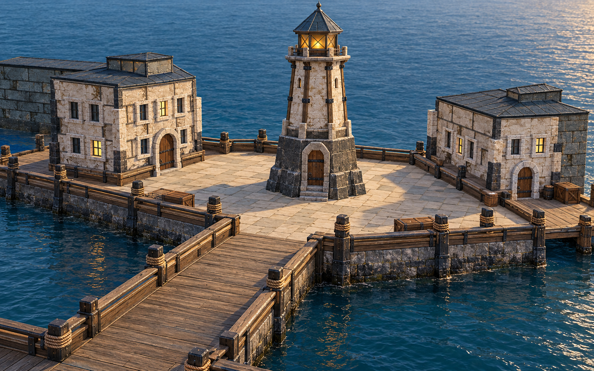
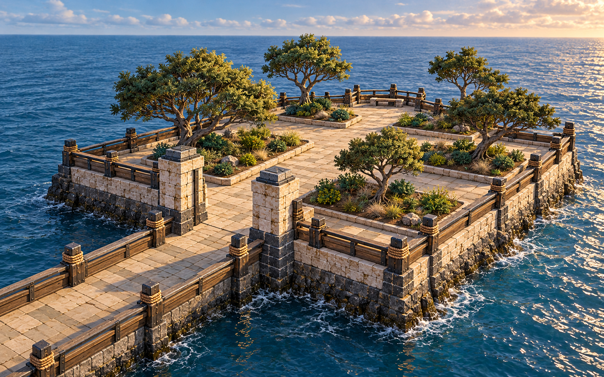

# Lantern Quay environment mesh reference

Current distribution status: the [2026-11-03 Meshy rights review](../godot/assets/meshes/README.md) supersedes earlier provisional Meshy-permission caveats in these import notes. The owner confirmed paid/private generation; official terms permit distribution of that output. Third-party notices remain applicable.

[Download the full PNG](images/lantern-quay-meshy-environment-concept.png) for Meshy. It shows the desired common material language: weathered pale block stone, a charcoal base, dark slate roofs, aged timber, iron straps, deep windows, and rope-wrapped pier posts. The archive and other building doors use the lighthouse's arched timber-and-iron proportions. Keep the central causeway and the tower/court relationship readable.

For a replacement GLB, separate the pier, archive, and other buildings into sensible mesh objects if Meshy allows it. The image is a design reference rather than a measured plan: preserve the playable route widths, world coordinates, door interaction points, and colliders from `hub_environment.gd` when integrating a model. A single generated view cannot define hidden sides or exact dimensions.

## Provenance

Created on 2026-10-21 with the built-in image generation tool. The two input references were original 1280 × 800 macOS Godot captures at `docs/images/tower-paint-match-court-1280x800.png` and `docs/images/tower-paint-match-archive-1280x800.png`. Those captures include the owner-supplied Stonewatch Beacon GLB and its extracted texture atlas, whose paid/private generation and distribution terms are recorded in the current Meshy rights review. The concept PNG is separate from the runtime assets and is not included in the playable scene. Check rights for any mesh generated from it before distributing that mesh in the open-source project.

## Generation prompt

> Create one polished wide three-quarter elevated 3D render of Lantern Quay, keeping the recognizable central tapered lighthouse tower and symmetrical central causeway, low civic archive building on its left, matching lower harbor buildings on its right, narrow connected docks and seawalls over water. Make the surrounding pier and buildings feel designed by the same mason and carpenter as the tower: weathered pale limestone block walls with shallow relief and irregular faces, dark charcoal stone plinths and corner buttresses, warm aged timber with dark iron hardware, practical slate roofs, deep framed mullioned windows with a few soft amber lights. The archive has a stout arched plank door with iron straps/ring and pale voussoir arch like the lighthouse base. Piers have substantial weathered wooden decking, timber rails, short stone sea walls, clearly modeled rope wraps and mooring posts. Maintain modest early-2000s BioWare RPG scale and quiet harbor mood, plausible construction, deliberately readable simple masses and clear separations for 3D reconstruction. Camera about 25 degrees above ground, showing front and one side of buildings and pier, tower fully visible; architectural visualization, clean realistic game-ready 3D materials, consistent neutral late-afternoon light, crisp edges. No people, no HUD, no minimap, no labels, no text, no logos, no fog, no depth of field, no fantastical extra structures.

## Garden beyond the port gate

[Download the garden PNG](images/lantern-garden-meshy-concept.png) for the garden art reference. The image was generated on 2026-10-21 from the original `docs/images/hub-east-gate-open.png` Godot layout capture and the quay concept above as a material reference. The PNG is a design target, not a measured layout or imported game asset. A derived Meshy garden GLB is now fitted to the playable tide-gate route; its source and rebuild are recorded below. The source GLB rights caveat also applies to that derivative.

### Garden generation prompt

> Create a new polished wide elevated three-quarter 3D render of the small coastal garden just beyond Lantern Quay's east port gate. Keep the narrow straight causeway crossing blue sea into a raised, enclosed garden terrace, with the pale weathered limestone gate posts and dark charcoal stone footing on the near side. The garden is a modest walkable RPG destination, about the scale suggested by the blockout, bounded by a low stone seawall and weathered timber rail. Show five distinct wind-shaped coastal trees with visible trunks and separate leafy canopies, varied height and spacing, in planted earth beds with sparse grasses and low shrubs. A clear stone footpath threads between them to a small overlook at the far edge; leave enough open walking space for a player. Match the lighthouse/pier construction language from the quay reference: pale rough-cut stone, deep joints, dark stone base, slate and weathered wood accents, restrained rope and iron details. The trees should be plausible hardy harbor trees, not tropical palms or a dense forest. Camera 25 degrees above terrace, showing front and one side of the gate and the whole garden platform; crisp complete object silhouettes and visible ground contact, consistent late-afternoon coastal light and soft clouds, clean game-ready 3D concept render useful for mesh reconstruction. No people, no HUD, no minimap, no labels, no text, no logos, no floating landmass, no extra city or lighthouse, no fog or depth of field.

### Located Meshy exports

The supplied garden export is at `~/Downloads/Meshy_AI_Seaside_Garden_Terrac_1021060957_texture.glb` (143,647,300 bytes; SHA-256 `b6eafb660b88005088d96685c07f5f5ea509a7908ab0a66a52c76a86443f8d9e`). It is one fused mesh with about 2.52 million vertices and 4,498,292 triangles, one material, and three embedded 2048 × 2048 JPEG maps. It has no animation. The earlier harbor export is at `~/Downloads/Meshy_AI_Harborlight_Haven_1021055349_texture.glb` (SHA-256 `552cda02bb8a12d94db58b604f8c12abd7c9d93702c548f2a3f7e6d999ecb416`), with about 0.45 million vertices and 0.84 million triangles. Its packed UV maps have many unrelated stone, wood, and foliage islands, so they are not repeated directly on the scene's dock geometry.

Both raw exports remain untouched outside the repository. [`tools/prepare_garden_mesh.sh`](../tools/prepare_garden_mesh.sh) pins the garden source by SHA-256 and uses `gltfpack 1.3` to produce [`garden_optimized.glb`](../godot/assets/meshes/garden_optimized.glb) (39,040,004 bytes; 899,658 triangles; SHA-256 `14e0087e7e86782648dc120ba0e656233541ce0035e5bb2846972fd456a1e358`). The one-mesh derivative retains three embedded 2048 × 2048 JPEG maps and needs no runtime mesh compression extension. It is the playable garden visual; see the actual Godot [bridge approach](images/garden-imported-approach-1280x800.png) and [overhead view](images/garden-imported-overview-1280x800.png). Godot rotates it `−90°`, scales it `9.2`, and fits its bridge to the west tide gate; separate scene-owned terrace and bridge-ramp collision provide the walking surface. The in-game map uses the fitted route, X `36..50` and Z `−8..4`, with a causeway at X `30..36` and Z `−4..0`, plus a path and four bed outlines that follow the imported layout in the [expanded map capture](images/garden-imported-expanded-map-1280x800.png). A garden blockout remains only as a missing/invalid-GLB fallback. This is still a substantial visual mesh, and its physical Steam Deck performance has not been measured. Redistribution rights for the supplied Meshy exports and derivatives remain unverified; the repository's MIT code license does not cover them.
