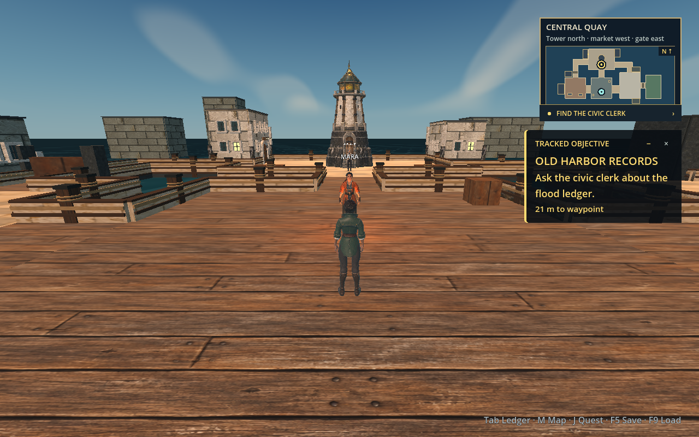
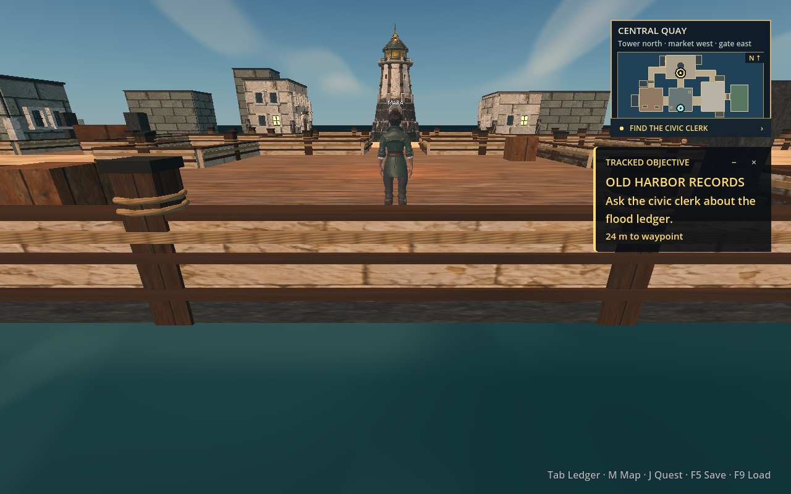
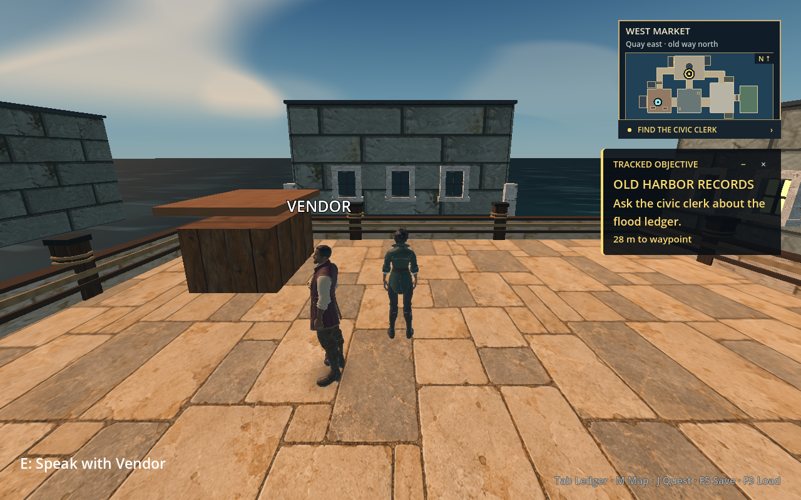
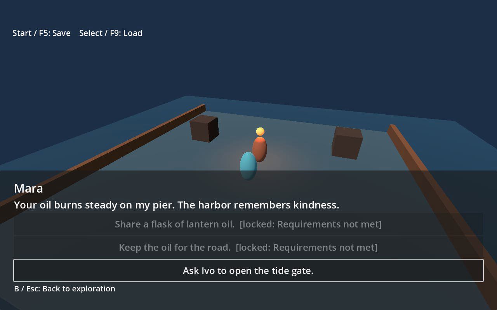
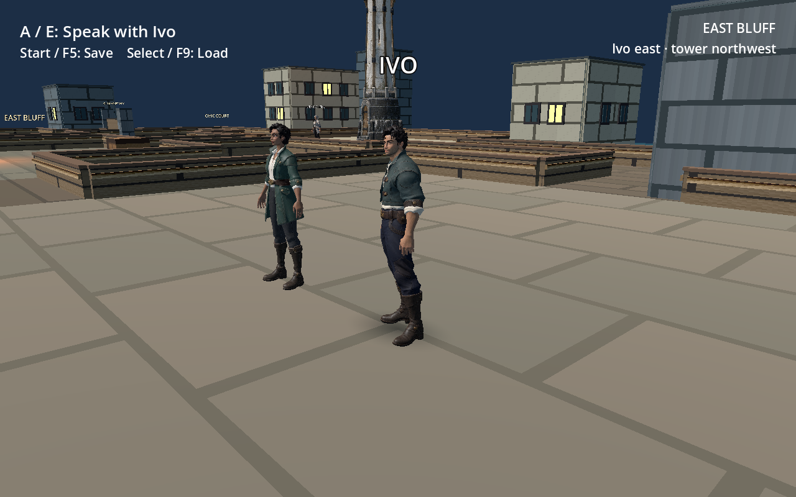
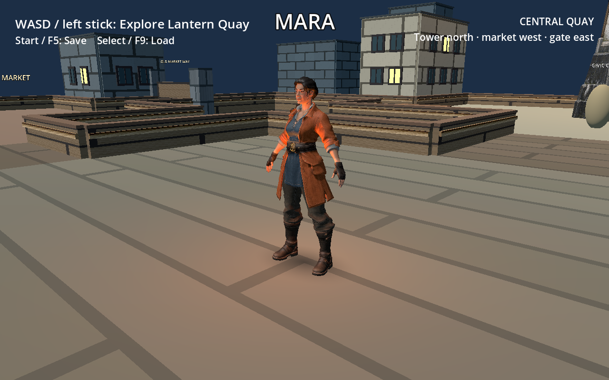
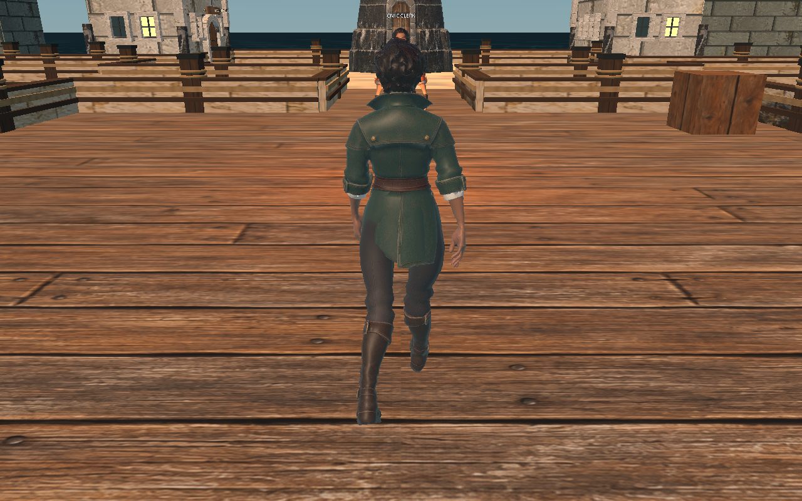
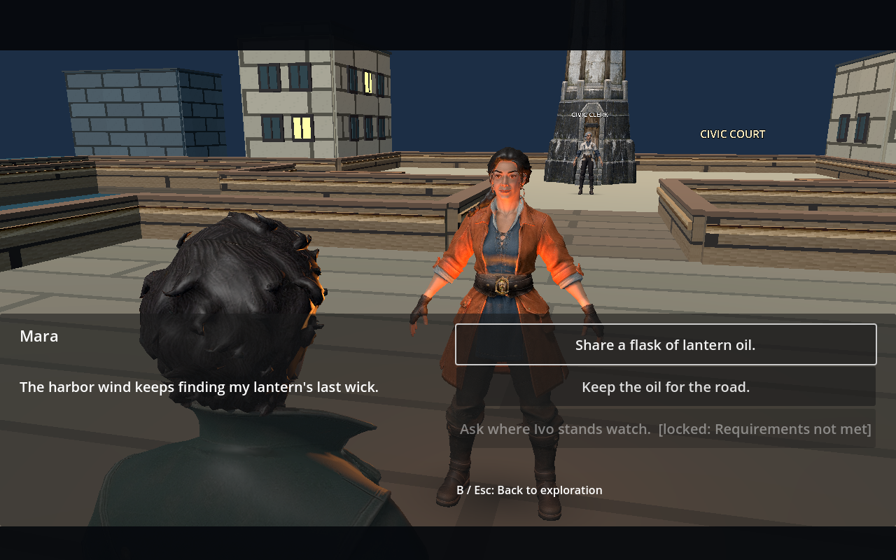

# Play and development notes

This document preserves the detailed play, asset, validation, and design notes from the project README. For a current scope summary, see [release status](release-status.md).

The launcher opens **New / Load Game** and an illustrated combat-style chooser. **01 Command, 02 Flow and 03 Vanguard** have playable garden chapters and live 3D overviews. Command uses party switching, pause and queued orders; Flow uses direct attacks, four styles, Chi and Focus; Vanguard uses aimed firearms, shields, heat, cover and squad powers. Their implemented scope differs; see the [release status](../docs/release-status.md). Styles 04–09 are marked **Coming soon** and retain their design previews. Chapter-generation automation remains proposed.

## Play The Quay Robbery

Choose **The Quay Robbery** on the title screen, or open **Combat styles → Command, Flow or Vanguard → Overview**. In a new journey, Mara hears a crash from the clerk's office while the tower is dark. Visit the clerk and the ransacked payroll chest, recruit Mara, and meet Ivo at the garden gate. Defeat the Crimson Raider and his mechanical guards, search the raider for the payroll pouch, then return it to the clerk. The workers are paid and the tower illuminates the quay. Donating oil to Mara can restore that light earlier.

This story is revision 7. Start a new journey to play it; incompatible earlier story saves are rejected without overwriting them. The optional harbor-history booklet is not required for combat.

Command pauses on contact. Select Tessa Ward, Mara or Ivo, choose an action and its target, then press Space to resume. Tab or the portraits switch companions; I opens the party sheet. The sheet includes equipment comparisons, powers, inventory, companion behavior, a workbench and save/load. Separate Command and Flow chapter saves preserve the Lantern Quay journey. The journey save includes chapter completion; Vanguard does not yet save an encounter in progress.

See [Command implementation and acceptance](../docs/combat-implementation/command-host.md), [UI copy review](../docs/ui-copy-review/README.md), and [adversary modeling references](../art/concepts/adversaries/README.md). Physical controller/Steam Deck testing and the remaining Command design scenarios are not claimed complete.

## Play Lantern Quay

Use Godot **4.3.stable** and Rust **1.95.0**. The GDExtension uses the exactly pinned `godot-rust 0.2.4` API for Godot 4.3. From the repository root:

```sh
sh scripts/build-host.sh
/Applications/Godot.app/Contents/MacOS/Godot --headless --path godot --import
/Applications/Godot.app/Contents/MacOS/Godot --path godot
```

On another host, use your Godot 4.3 executable in place of the macOS path. Start on the central quay and use WASD or the controller left stick to explore. The close third-person camera eases behind turns; A/D begin with a measured lateral step and turn, while the controller left stick steers directionally. S or a backward stick pull backpedals without flipping the view. A held direction stays straight as the view turns; a continuous left-stick sweep steers smoothly, and each WASD key change reorients from the current view. Drag with the right mouse button or use the controller right stick to orbit and tilt the camera; the chosen heading stays until you recenter or change scenes. Middle drag pans temporarily, and the wheel zooms. Press F or click the controller right stick to recenter both pan and heading. The [camera behavior and tuning notes](../docs/camera-follow.md) explain the movement basis and follow timing. Walk near an NPC, then press E or south/A to speak. Dialogue blends to a letterboxed, over-the-shoulder view of the NPC and restores your exploration orbit afterward. Use the D-pad or left stick to move between choices, south/A to confirm, and east/B or Esc to return to exploration. Dialogue leaf lines also offer a selectable Leave choice.

The quay has a compact, north-up map with district guidance and an objective tracker during exploration. Press M or controller Back/View to toggle the expanded map; Esc or controller east/B also collapses it. Active quest text is yellow; completion turns it green. Use the tracker's −/+ button to collapse or expand it, or ×, J, or controller north/Y to dismiss it. Clicking the quest row at the bottom of the minimap restores the expanded tracker, including after dismissal. J/Y also restores it, and a new objective stage brings it back. Press Tab or controller Start/Menu for the journal; its Character, Equipment, Inventory, Map, Load, and Save pages can be browsed with arrow keys or the D-pad, with left/right or LB/RB for pages. Enter or south/A selects, while Tab, Esc, or east/B closes it. Equipment is currently a display placeholder. F5 and F9 remain keyboard quick save and load; the journal has Load and Save actions. Start/Menu and Back/View are used for the journal and map, respectively. The revision-4 hub uses a new local save slot at `user://oathshaper_hub_v4.save.json`; the revision-3 save stays at its old path. Muted lower-right key hints follow the last keyboard, mouse, or controller input; controller confirm and back appear as circled Ⓐ and Ⓑ. The interface is laid out for 1280×800.

Follow the tracked objective from the clerk's office to Mara, Ivo, the raider, and back to the clerk. The office chest remains in place and shows returned coins after the handoff. Oil sharing affects Mercy and Ivo's affinity but does not grant permission to confront the thief. The clerk's cabinet offers optional harbor history, and her market shortcut is available without a morality requirement. See the [story review and rendered lighting evidence](../docs/story-reset-20261025/review.md).

The [quay](../docs/images/material-pass-quay-1280x800.png), [court](../docs/images/material-pass-court-1280x800.png), [market](../docs/images/material-pass-market-1280x800.png), and [seawall](../docs/images/material-pass-seawall-1280x800.png) renders show the mapped dock, stone, and timber at 1280×800 on macOS. The playable garden now uses an [optimized derivative](../godot/assets/meshes/garden_optimized.glb) of the owner's Seaside Garden GLB: its stone terrace, bridge, planters, trees, and railings replace the blockout visuals. See the [bridge approach](../docs/images/garden-imported-approach-1280x800.png), [garden path](../docs/images/garden-imported-interior-1280x800.png), [overhead layout](../docs/images/garden-imported-overview-1280x800.png), and [fitted map](../docs/images/garden-imported-expanded-map-1280x800.png) in 1280×800 macOS Godot captures. The earlier [garden blockout render](../docs/images/material-pass-garden-1280x800.png) predates the import. The garden floor, ramp, and gate use simple scene-owned collision. The [mesh reference and provenance](../docs/meshy-environment-reference.md#located-meshy-exports) explain the source and rebuild.









The original [Mara](../art/concepts/mara-meshy-reference.png), [Ivo](../art/concepts/ivo-meshy-reference.png), [player](../art/concepts/player-meshy-reference.png), [civic clerk](../art/concepts/civic-clerk-meshy-reference.png), [vendor](../art/concepts/vendor-meshy-reference.png), and [lantern tower](../art/concepts/lantern-tower-meshy-reference.png) concept images are modeling references. The scene uses user-supplied textured Meshy GLBs for [Embercoat Mara](../godot/assets/meshes/mara.glb) and [Ivo](../godot/assets/meshes/ivo.glb), plus a [shorter civic derivative](../godot/assets/meshes/lantern_tower_civic.glb) of the owner's tower export. The [Emerald Corsair player](../godot/assets/meshes/rigged/player_rigged.glb), [Mara](../godot/assets/meshes/rigged/mara_rigged.glb), [Ivo](../godot/assets/meshes/rigged/ivo_rigged.glb), [Ironclad Matriarch civic clerk](../godot/assets/meshes/rigged/clerk_rigged.glb), and [Harbor Merchant vendor](../godot/assets/meshes/rigged/vendor_rigged.glb) use rigged derivatives of the owner's textured GLBs. The player plays skeletal `Idle` and in-place `Walk`, reversed for backpedaling; the NPCs play `Idle` and a subtle `Talk` during conversation. Their [original exports](../godot/assets/meshes/README.md) remain untouched as fallbacks. NPC grounding and contact shadows remain scene-owned. The [rigging guide](../docs/rigging.md) describes the reproducible Blender process and remaining animation gaps.

New [generated material maps](../godot/assets/textures/materials/README.md) cover the dock, pale and dark seawall courses, rope-lined posts, crates, bluff rock, slate roofs, office surfaces, and the garden's blockout fallback. The imported garden retains its own embedded Meshy material maps. The supplied tower's [extracted texture atlas](../godot/assets/textures/README.md#stonewatch-beacon-atlas-extracts) supplies separate stone details around the archive and market. The [Market Bridge dock package](../art/meshy/dock/README.md) contains four measured Godot views and a [polished single-image concept](../art/meshy/dock/05-polished-single-view.png) for a Meshy trial; no dock or building GLB is imported. The imported characters retain scene-owned collision, interaction, and dialogue; The tower's footprint and beacon lighting remain in Godot; Mara has no personal spill light. The owner reports paid-plan, private generation of the supplied GLBs; complete input-source mapping and the first-party media grant remain pending. The project's MIT code license covers its code, not those GLBs or extracted maps. See the [model provenance and import notes](../godot/assets/meshes/README.md), [texture provenance](../godot/assets/textures/README.md), and [concept provenance](../art/concepts/README.md).







The current [walk frame](../docs/images/rig-player-walk-after-frame-07-1280x800.png) and [before frame](../docs/images/rig-player-walk-before-frame-07-1280x800.png) show the straighter shin and boot lanes in actual 1280×800 Godot captures. The dock material changed between those captures; compare the character silhouette and boots at the matched camera and animation frame. The [clerk](../docs/images/rig-civic-clerk-idle-1280x800.png), [vendor](../docs/images/rig-harbor-merchant-idle-1280x800.png), and [Ivo dialogue](../docs/images/rig-ivo-talk-1280x800.png) frames show their rigged scene imports. These are first-pass clips; close coat weights, gait transitions, and gestures still need art polish.

The [current Mara dialogue frame](../docs/images/dialogue-mara-repeat-rigged-1280x800.png) shows her narrower standing pose, the completed Ivo question, and the Leave choice. The quest tracker has [active](../docs/images/oathshaper-quest-active.png), [collapsed](../docs/images/oathshaper-quest-collapsed.png), and [completed](../docs/images/oathshaper-quest-complete.png) 1280×800 desktop captures.



The [keyboard prompt](../docs/images/hints-keyboard-near-mara-1280x800.png), [controller prompt](../docs/images/hints-controller-near-mara-1280x800.png), and [controller dialogue hint](../docs/images/hints-controller-dialogue-mara-1280x800.png) are rendered 1280×800 checks of the earlier adaptive controls. These captures predate the records route and journal.

```sh
GODOT_BIN=/Applications/Godot.app/Contents/MacOS/Godot sh scripts/check.sh
sh scripts/check-linux.sh
```

`check.sh` runs Rust formatting, Clippy, tests, story and continuity validation, a host extension build, and its configured Godot headless checks. `check-linux.sh` builds a Linux x86-64 release extension and runs the configured Godot checks in a Linux container. It downloads the official Godot 4.3 Linux binary into ignored `godot/bin/` and checks its SHA-256. Docker must be available. The [hub verification notes](../docs/hub-expansion.md#validation-boundary) distinguish the earlier checks from validation of the records route and journal. Neither script substitutes for a physical controller or Steam Deck playtest.

The [combat performance notes](../docs/combat-performance-20261027/HANDOFF.md) include before/after frame timings and a rendered benchmark you can run locally. Development builds now optimize the Rust extension while retaining debug symbols and assertions. The continuity checks include simulation pacing and smooth movement between combat ticks.

See the [architecture](../docs/architecture.md), [dialogue authoring guide](../docs/authoring.md), [rigging guide](../docs/rigging.md), [hub expansion notes](../docs/hub-expansion.md), [reuse audit](../docs/reuse-audit.md), and [M1 verification record](../docs/milestone-1.md). Historical logs and review reports are [public evidence copies](../docs/EVIDENCE.md).

## Combat research and proposed foundation

The [RPG design review workspace](../docs/combat-design/README.md) tracks the shared LCD contract and independent per-profile designs, including skills, equipment, inventory, progression, magic/tech and native UX. Its review records distinguish design evaluation from playable implementation.

The [combat prior-art study](../docs/research/001-combat-systems-prior-art.md) and [foundation plan](../docs/combat-foundation-plan.md) propose a shared Rust RPG model. The [ATB extension](../docs/research/005-three-atb-profiles.md) separates Momentum, Confluence and Cadence timing and command rules. The plan covers party control, inventory/equipment, abilities, narrative consequences, save boundaries, reference prototype reuse and trials in the imported garden.

Open the [original interactive study](../docs/design/combat-profile-preview.html) for the six-family design. The [implemented Godot front end](../docs/combat-front-end.md) adds title/profile saves, gear and ability pages, Mercy beside the avatar, and practice weapon animation. Command, Flow and Vanguard have separate playable runtimes; styles 04–09 remain design previews. See the [release status](../docs/release-status.md) for implemented features and limits.

## Playable storyboard research

The [playable storyboard research specification](../docs/research/008-playable-storyboard-content-pipeline.md) proposes a creator workflow built on the tower and garden imports: block out a locale, project approved concept art, rehearse with flat characters, produce selected meshes, and turn narrated playthroughs into approved revisions. It records existing evidence, provider pose controls, shared scene contracts and an education-focused pilot; the integrated authoring tools remain proposed.

## Continuity checks

The [continuity research and specification](../docs/research/010-continuity-checking-pipeline.md) covers recurring quest, dialogue, companion, camera and voice checks. Its Rust checker evaluates authored dialogue-applicability rules without Obelus or an LLM, then replays authored choice sequences through the game's narrative evaluator. The chapter manifest connects these checks to current Godot fixtures and one evidence report. The [dialogue script checker](../docs/dialogue-script-checker.md) also explores enabled conversation branches and flags repeated phrases across player and NPC speech. Automatic discovery of world traversal routes and editor integration remain proposed. The [playtest verification](../docs/playtest-polish-20261026/HANDOFF.md) records the preceding gameplay fixes and their limitations.

Run the current chapter's narrative replays and Godot fixtures with `python3 scripts/check-continuity.py`. Each run saves a readable report, action traces and engine observations under `.artifacts/continuity/`; `--logic-only` explicitly limits the scope. The [continuity lab](../docs/tutorials/continuity-lab.md) explains the checker through a reproducible fault. The [teaching research proposal](../docs/research/011-agent-assisted-game-design-teaching.md) starts with students building a short game with an agent, then learning the systems behind it.

## Earlier follow-up milestones

1. Polish the player gait, turning, foot contact, and NPC gestures; profile the skinned models on target hardware.
2. Add in-editor graph, localization, and hub wayfinding tools backed by the existing stable IDs and validator.
3. Add typed event mappings for a small combat encounter, save migrations, accessibility controls, and physical Steam Deck testing.
