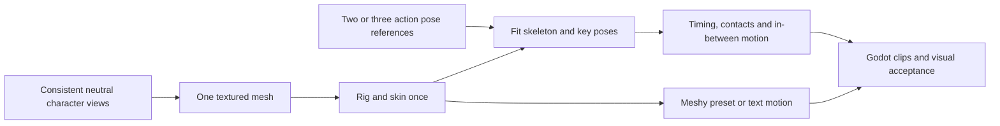

# Pose-guided character animation

> Comparative research and independent design proposals. See the [Research and third-party rights notice](NOTICE.md); references do not imply affiliation or permission to reuse source-game assets.

Research date: 2026-10-22. Focused review; six primary documentation sources, including a same-day refresh of neutral-pose generation controls. This is a proposed addition to the chapter asset workflow, not an implemented Meshy integration or a paid generation run.

## Summary

Two or three reference poses can guide an animation on one rigged character. Meshy's Image to 3D and Multi-Image to 3D APIs do support neutral-pose selection through `pose_mode` (`a-pose`, `t-pose`, or an empty value). Its rigging and animation APIs are separate: the reviewed animation contract supports preset actions or text-generated motion, and does not document a pose-image sequence input.

## 1. What the APIs provide

| Operation | Documented input and output | Role in Oathshaper |
| --- | --- | --- |
| [Image to 3D](https://docs.meshy.ai/en/api/image-to-3d) | Image → model, with `pose_mode` selecting A-pose, T-pose or no specific pose | Request a neutral pose suitable for subsequent rigging; this is a generation control, not animation. |
| [Multi-image to 3D](https://docs.meshy.ai/en/api/multi-image-to-3d) | One to four images of the same object from different angles → one model; also exposes `pose_mode` | Consistent front/side/back references in the same neutral pose. Different action poses are not an animation sequence input. |
| [Rigging](https://docs.meshy.ai/en/api/rigging) | Textured humanoid model/task → skeleton and skinned mesh; optional walking/running clips | Bind one approved character. Verify facing, scale, limb separation and clothing deformation. |
| [Animation](https://docs.meshy.ai/en/api/animation) | Completed rig task plus a preset action, several actions, or a generated motion task | Obtain named clips on the same character; multiple actions produce separate clips in one file. |
| [Text to Motion](https://docs.meshy.ai/en/api/text-to-motion) | Text description and duration → motion clip | Generate a custom gesture or action, then apply it through Animation or retarget locally. No image-pose parameter is documented. |

This review establishes the public API contract, not output quality. A private or future provider feature may differ; confirm it before promising direct pose-image animation.

## 2. Proposed pose workflow

**Rigging** builds the skeleton; **skinning** weights the mesh to its bones; **keyframe animation** changes bone transforms over time; **retargeting** transfers motion to another compatible skeleton.

The proposed custom path uses an agent-assisted Blender adapter to fit the canonical rig to reference poses, followed by human review. The adapter does not exist yet. Pose images supply artistic constraints; they do not fully specify depth, joint orientation, balance or timing. Separately generated posed GLBs may have different topology, proportions and clothing. Treat them as references, not interchangeable frames or directly compatible morph targets.

For a strike, author wind-up, contact and recovery poses with timestamps. Blend back into the existing guard. For a walk, inspect both contact poses and passing poses, foot plant duration, knee direction, pelvis travel and loop continuity. Two or three images can communicate intent but are insufficient evidence of a production-ready walk. Use an established clip when it meets the design, then correct it on the same rig.

In Godot 4.3, use a BoneMap/SkeletonProfileHumanoid and inspect rest transforms as well as bone names. Godot's [retargeting guide](https://docs.godotengine.org/en/4.3/tutorials/assets_pipeline/retargeting_3d_skeletons.html) documents rest-pose and scale differences that can distort animation or change stride. Test any new Meshy rig separately before replacing the currently working character.

## 3. Asset contract and acceptance

Extend the proposed chapter manifest with `canonical_mesh_hash`, `rig_hash`, `bone_profile`, reference image hashes/rights, `clip_id`, source task IDs, generation settings, duration, loop mode, root-motion policy, contact markers and review captures. Keep optional image references separate from the provider request: do not invent unsupported API fields.

First experiment: one existing character, one walk and one three-pose practice strike. Compare a Meshy motion clip with the local authored pose route. Measure generation cost, manual repair time and visible defects before choosing a default.

Acceptance should include front/side/rear playback, planted-foot sliding, straight knee/foot alignment, clothing tearing, hand/weapon contact, loop seams, movement-speed matching and transitions between idle, walk, guard and strike. Store the approved animation library separately from the source model. Animation markers remain presentation data; the future deterministic combat rules own hit eligibility, damage and costs.

## Gaps and method

- Reviewed Meshy's image-to-3D, multi-image, rigging, animation and text-to-motion endpoint schemas, plus the project's pinned Godot 4.3 retargeting documentation. Neutral-pose selection was reconfirmed in the same-day [playable storyboard research](008-playable-storyboard-content-pipeline.md).
- Direct image-pose-conditioned motion is not in the reviewed public contract. Local pose fitting, animation cleanup automation and the AssetProvider adapter remain work to implement.
- No API key was used, no credits were spent, and no output quality or character compatibility is claimed from documentation alone.
- Blender manual fetches failed during this review; no Blender-specific API contract is asserted here.
