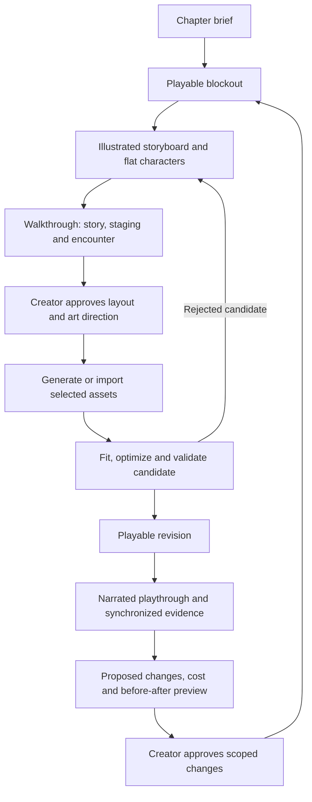

# Playable storyboards and the world-content feedback loop

> Independent research and an Oathshaper design proposal. See the [research and third-party rights notice](NOTICE.md). Product references do not imply affiliation or permission to redistribute their assets.

Date: 2026-10-22. Research depth: **focused**, with a quick terminology follow-up for facade projectors. Origin: Ben's observation that the tower and garden establish the beginnings of an image-to-playable-world pipeline, and his proposal to extend it into an accessible, iterative chapter-authoring workflow. Status: **research specification; the integrated creator workflow is not implemented**. Twelve official technical/documentation sources were reviewed alongside live local source and asset inspection. No generation credits were spent.

## Research summary

Oathshaper can make a playable storyboard the durable starting point for a chapter: simple geometry, flat characters, dialogue, encounter rules and camera staging are reviewed together before expensive art is commissioned or generated. Approved images and meshes then replace the scene's visual representations while preserving its identities and behavior. Narrated playthroughs can feed a reviewable change proposal, followed by a new playable revision and comparison against the previous one.

The tower and garden demonstrate parts of this workflow locally. They do not yet establish repeatable professional asset quality, a quantified cost advantage or an automated end-to-end pipeline; those are explicit subjects for the pilot below.

## 1. Key findings and current evidence

1. **Image-directed environment development has already produced playable assets.** The [environment reference record](../meshy-environment-reference.md) preserves generated harbor/garden concepts, source-export provenance and import evidence. The tower and garden appear in Oathshaper's runtime. The garden's source is pinned by hash and its derivative has a reproducible [optimization script](../../tools/prepare_garden_mesh.sh). The provenance trail is partial: original provider requests and generation charges are not recorded for all supplied assets.
2. **Geometry fitting is part of content production.** The current [GardenLayout](../../godot/scripts/garden_layout.gd) applies a common entrance fit, enlargement and rotation to the garden. [Environment construction](../../godot/scripts/hub_environment.gd) and the [map](../../godot/scripts/map_widget.gd) consume it. This is the seed of a scene contract that should eventually drive every representation. Earlier documentation describes an older fit; the current script is the inspected implementation.
3. **Visual quality alone does not establish a production asset budget.** Direct inspection of `garden_optimized.glb` found one mesh, one material, 899,658 triangles and 39,040,004 bytes. It is an effective local demonstration, but LODs, memory, frame time, collision and editing granularity still need measurement. The [garden route test](../../godot/tests/garden_mesh_test.gd) exercises traversal; it does not certify Steam Deck performance.
4. **A low-cost intermediate representation already has local prior art.** In the sibling reference prototype checkout, `scenes/interactive_demo.gd` constructs front/back `Sprite3D` cards, voxel shells and a projected flat mesh. `rules/core/directional_sprite_selector.gd` implements camera-relative direction selection with hysteresis. These are inspected source implementations, not a newly validated Oathshaper integration. See the local evidence register below.
5. **Pose selection exists in Meshy's API.** Both [Image to 3D](https://docs.meshy.ai/en/api/image-to-3d) and [Multi-Image to 3D](https://docs.meshy.ai/en/api/multi-image-to-3d) expose `pose_mode` with `a-pose`, `t-pose`, or an empty value. This controls a generated model's pose. The reviewed animation interface accepts preset actions or text-generated motion; it does not document a two/three-image sequence as animation input. The [animation research](004-pose-guided-character-animation.md) now makes that distinction explicit.
6. **The main research question is the cost of an accepted revision.** The proposed advantage is that creators can judge scale, pacing, staging and interaction early, then carry those decisions into richer art. Whether that produces more experimentation or richer stories must be measured through playtests, repair time and creator outcomes, not inferred from attractive screenshots.

## 2. Creator experience

The creator should be able to say, “The archive needs to be wider, with taller colonial windows; keep its door connected to the clerk's records quest,” and review a changed playable scene. They should not need to rebuild the quest simply because its building received new art.

| Stage | What the creator does | What remains playable | Saved output |
| --- | --- | --- | --- |
| Brief | Describe a locale, mood, story beats, cast and intended encounter | A small template chapter | Chapter brief and style references |
| Block | Place/resize simple buildings, paths, gates and encounter spaces; optionally use voxels | Movement, camera, collision, doors and actor interaction | Measured layout with stable IDs |
| Illustrate | Choose a rendered concept view; project approved artwork onto simple surfaces; add flat character art | The same chapter with a richer storyboard appearance | Registered images, camera poses and projection coverage |
| Rehearse | Walk the scene, try dialogue branches, test pacing and encounter rules | Full intended story flow at prototype fidelity | Playthrough, branch coverage and feedback |
| Approve art direction | Compare variants such as larger buildings or a different architectural vocabulary | Approved storyboard remains runnable | Versioned layout, style and story baseline |
| Produce | Generate/import selected buildings, scenery and characters | Storyboard remains available while assets process | Candidate meshes/materials/rigs with provenance |
| Fit and compare | Review scale, routes, doors, camera clearance and appearance | Candidate and previous revision can both be played | Accepted replacement or a rejection with reasons |
| Iterate | Narrate feedback during a playthrough and approve a concrete change set | A new revision after validation | Evidence-linked changes and reversible history |

“Approved” means approved for the next production step, not permanently locked. A later layout change invalidates affected projections and fit checks; it does not require regenerating unrelated characters or rewriting their dialogue. A flat or voxel presentation can also be the chosen final art style.

## 3. A scene contract that survives changes in art

### Separate meaning, space and appearance

The chapter needs three related layers:

- **Meaning:** actors, dialogue entry IDs, story conditions, quest objects, encounter participants, exits and save identity.
- **Space:** transforms, footprints, path widths, interaction anchors, walkable surfaces, camera constraints and connection points.
- **Appearance:** block meshes, image projections, flat actors, voxels, imported meshes, materials, rigs, lighting and sound.

An archive can change from a box to an illustrated facade to a detailed building while retaining `archive.west`, its entry anchor and its records quest. A character's narrative identity similarly survives a change from a flat card to a skinned mesh. The existing [Rust story model](../architecture.md) remains authoritative for story state; geometry and image generation do not invent committed narrative facts.

Use authored anchors for doors, stairs, gates, foot placement, weapon sockets and dialogue framing. Each connection records position, orientation, width and elevation. Generated geometry is fitted to these anchors, or the creator explicitly approves a revised layout. Either direction is supported: the garden showed that adapting the map to a good mesh can be preferable.

The minimap, collision and navigation must derive from the same accepted spatial revision. Replacing a picture or mesh must not silently move an exit, obstruct a path or leave the map showing an earlier layout.

### Proposed authoring records

These are design requirements, not existing serialized types.

| Record | Minimum information |
| --- | --- |
| `ChapterRevision` | Parent revision; story/locale/encounter versions; chosen combat contract; required playthroughs; author and approval state |
| `LocaleObject` | Stable ID; semantic role; bounds/transform; anchors; movement and camera constraints; visual variants |
| `StyleGuide` | Approved architecture, materials, palette, proportions, lighting references; image hashes; input-rights notes |
| `StoryboardShot` | Scene revision; camera transform and projection; viewport; color/depth/object-ID captures; concept image; registration/coverage |
| `AssetCandidate` | Target object IDs; source hashes; provider/model/settings; task ID; raw and derived files; fit; geometry/texture budgets; rights evidence |
| `PlaythroughSession` | Build/content IDs; initial save; video/audio; synchronized inputs/events/camera/object IDs; optional deterministic seed |
| `ChangeProposal` | Timecoded observations; affected IDs; explicit edits; dependencies; uncertainties; before/after views; cost cap; acceptance checks |
| `ReviewDecision` | Approver; exact proposal/version; accepted/rejected parts; reason; authorized spend/scope; supersession record |
| `PlayableBuild` | Accepted content hashes; migrations; validation results; captures; hardware measurements; rollback target |

Generation recipes are reproducible records, not a promise that a stochastic provider will return identical bytes. Preserve accepted outputs and their hashes so a chapter remains buildable without regenerating them.

## 4. Projected concept art and flat actors

### Four facade projectors: preserve the illustration on simple geometry

Ben's refinement is to surround a simple building with four virtual image projectors, one for each wall. Each projector places an approved facade image onto its assigned surfaces; one or two images may be reused or mirrored for the remaining walls. The building can retain detailed painted stone, windows and ornament while its underlying geometry remains a small set of blocks. This is an intended intermediate or final representation, with visual fidelity to be evaluated at the actual gameplay camera distances.

The established general term is **projective texture mapping**. NVIDIA's [technical note](https://developer.download.nvidia.com/assets/gamedev/docs/projective_texture_mapping.pdf) describes the same slide-projector analogy and the separate projector/viewer transformations. For straight-on building elevations, each wall uses **planar projection**; an arrangement around a box is commonly described as **box/cubic projection**. **Triplanar mapping** is a related technique that blends three axis projections and is particularly useful for continuous material patterns. NVIDIA's [UV projector documentation](https://docs.omniverse.nvidia.com/materials-and-rendering/latest/projectors.html) distinguishes these projection types and texture-coordinate projectors from projector lights.

Proposed building workflow:

1. **Assign surfaces:** front, rear, left and right, plus a separate roof/top treatment. Four wall projectors do not cover a visible roof. A facade group may contain many polygons; the creator assigns the group once.
2. **Attach images:** use approved front/side elevations, or crop and rectify a planar facade from a perspective concept image. If the image's geometry disagrees with the blockout, review the registration first. Prefer orthographic projectors for rectangular elevations; use calibrated perspective projection when preserving a matching concept camera.
3. **Reuse intentionally:** let the creator select copy, horizontal mirror, crop, repeat or a new image for each side. Keep signs, unique doors and directional shadows in separately editable regions so mirroring does not reverse text or invent an entrance. Symmetrical window/stone patterns are stronger reuse candidates.
4. **Keep the art attached:** save projector transforms relative to the building. Walking around it changes the player's view of the textured surface; it does not move the paint. Resizing exposes an explicit choice between stretching the facade, repeating bays and preserving architectural feature sizes.
5. **Resolve boundaries:** use explicit facade assignments or dominant surface direction for crisp architectural edges. Blend only compatible surface patterns at selected transitions; indiscriminate blends can produce doubled windows. Masks and visibility tests prevent projection onto neighboring objects or through the building.
6. **Preview, then bake if useful:** keep interactive projector controls during authoring. For static accepted buildings, bake the result into an atlas or ordinary UV assignments to reduce runtime work. Use the same surfaces rather than coplanar overlay sheets, and keep the original projection recipe editable.

The proposed material uses the projected image as surface appearance, with scene lighting applied normally. An optional unlit illustration mode preserves a concept's painted lighting during storyboarding. Production materials should avoid conflicting baked shadows/highlights when dynamic lighting is important. No physical lamp object or light simulation is required to retain the projector authoring metaphor.

This can preserve a large amount of **surface** detail cheaply, but it cannot create an absent silhouette, doorway opening, balcony, window recess or correct near-view parallax. Add simple geometry where those features affect interaction, camera clearance, outline or visible depth; leave painted detail on broad walls. The amount of fidelity retained is a pilot result to measure, not a predetermined percentage.

Extend `LocaleObject` with facade groups and `StoryboardShot`/asset metadata with projector transforms, source-image region, mirroring/repetition policy, surface masks, roof treatment and optional baked output. Compare one-image reuse, two-elevation reuse and four authored elevations on the same building. Acceptance includes a full camera orbit, approach to the door, visible roof, resized building, seam inspection, unchanged quest interaction and a runtime cost comparison between live projection and baked output.

### Projection should preserve the blockout's geometry

Capture the blockout from a named camera and store its depth, object IDs and camera parameters alongside the ordinary image. Ask an image provider to develop the intended look using that composition, then compare its edges and landmarks to the blockout before projecting it back.

For a surface point, transform it through the recorded world-to-camera and projection matrices into image coordinates. Sample only if the point lies inside the source view, faces that view and passes an occlusion/depth check. Use object masks to prevent a painted window from spilling onto the neighboring tree or building. Camera projection is a proposed adapter here; it is not yet implemented in Oathshaper.

An image model can alter perspective, door placement or silhouette. Saving the camera matrix does not make those alterations geometrically correct. Offer a registration preview and allow rejection, masking, local warping or a new blockout revision. A single view supplies no reliable information about hidden walls; show uncovered surfaces plainly and add more registered views or authored materials. Never imply full 360-degree fidelity from one attractive camera angle.

For the first implementation, use simple mesh UVs or a compatible projection shader, with an optional baked texture atlas. Oathshaper currently selects Godot's Compatibility renderer; Godot 4.3's [Decal node is unsupported in that backend](https://docs.godotengine.org/en/4.3/tutorials/3d/using_decals.html). [ArrayMesh](https://docs.godotengine.org/en/4.3/classes/class_arraymesh.html) provides a documented route for authored surface attributes. Avoid coplanar overlays that reintroduce the shimmering seen at the dock seam.

### Flat character mode

Start with front/back character cards on the same actor anchors used by the final model. Preserve foot pivot, height, facing, interaction distance and camera targets. Provide a deliberate choice between fixed two-sided cards and camera-facing sprites; full billboarding can undermine authored facing during conversation.

Godot's [Sprite3D](https://docs.godotengine.org/en/4.3/classes/class_sprite3d.html) supports textures and atlas frames. reference prototype's inspected code offers local examples for cards, thin volumes and directional selection. Begin with the smallest useful set of views; use a coherent mesh-rendered turntable when more angles are needed, rather than assuming independent generated images have identical clothing and proportions. Artist-authored cards remain supported.

The narrative and encounter systems operate on the actor regardless of representation. Switching visual fidelity must not change selection hitboxes, turn order, movement budgets, dialogue history or saved identity. reference prototype source reuse requires an explicit dependency/license review; this spec records implementation ideas without copying sibling code or assets.

## 5. From approved storyboard to cohesive meshes

### A complete scene image is an art-direction reference

Render an approved whole-locale view to establish the common proportions, stone, timber, windows, doors, foliage and lighting. Export additional measured views and per-object crops where needed. Include a human-scale reference in review captures; exclude people/UI from reconstruction inputs when they would become unwanted geometry.

The generated view must remain distinguishable from an actual engine capture. A beautiful invented doorway is not evidence that the player can enter it.

### Support several production units

| Production unit | Useful for | Integration consequences |
| --- | --- | --- |
| Whole locale mesh | Fast scenic trials; a garden or distant vista | May fuse trees, paths and walls; harder to edit, cull or replace independently |
| Spatial chunks | A coherent courtyard, bridge or building exterior | Requires shared anchors and boundary inspection; easier local revision |
| Modular kit | Doors, windows, walls, rails and repeatable construction | Requires kit dimensions and assembly rules; supports many revisions cheaply |
| Retextured blockout/authored mesh | Approved geometry with a new material treatment | Preserves deliberate proportions; still needs UV/material inspection |

All four routes should be available. Start with a whole garden candidate when that is the fastest experiment, then divide or replace it only when interaction, performance or iteration requires it. Doors, cabinets, moving gates and destructible pieces need independent representations even if the surrounding scenery arrives fused.

Meshy's [Retexture API](https://docs.meshy.ai/en/api/retexture) documents applying textures to an existing model using text or reference images, with an option to preserve UVs. It is a candidate for keeping deliberately authored architecture while changing its appearance. This is a provider capability, not a verified guarantee of geometric/material fidelity in our scenes.

### Asset production and acceptance

1. Package the approved object/chunk bounds, anchors, image references, material guide and target budgets.
2. Select the provider operation and exact model version from its current supported contract. An image provider is replaceable; a particular GPT-image model name is not part of the chapter format.
3. Present expected charges, number of candidates and retry allowance before paid submission. Reuse cached candidates when the inputs and requirements have not changed.
4. Record the returned provider task ID immediately. Meshy's [task lifecycle](https://docs.meshy.ai/en/api/task-lifecycle) is asynchronous; resume observation after interruption instead of blindly creating another paid task. Handle an uncertain submission outcome explicitly.
5. Download and hash raw outputs; derive normalized/optimized runtime copies. Preserve scale, forward axis and the agreed local origin. Inspect material assignments, triangle count, texture memory and silhouette.
6. Fit visual geometry and simple collision to the shared spatial contract. Check passage widths, thresholds, slopes, actor headroom, camera clearance, seams and minimap agreement.
7. Compare the same walkthrough and fixed review cameras against the approved storyboard. Accept or reject the candidate with reasons; retain the previous playable build.

### Character pose and motion contract

Neutral-pose generation, skeleton binding and animation are separate operations. A provider adapter can request `pose_mode: "a-pose"` or `"t-pose"` for character generation. The [Rigging API](https://docs.meshy.ai/en/api/rigging) targets textured humanoids and documents a forward-axis requirement and mesh limits; check these before submission. The [Animation API](https://docs.meshy.ai/en/api/animation) applies library actions or a motion-task result; [Text to Motion](https://docs.meshy.ai/en/api/text-to-motion) accepts a motion description.

Two or three artist-approved action poses can still be used as keyframe targets on one canonical rig, but automatic image-to-skeleton fitting is a separate proposed adapter. Neither an A/T-pose switch nor multi-view reconstruction demonstrates that adapter. Test foot contacts, knee direction, clothing deformation, weapon sockets and transitions before accepting a clip. Keep gameplay hit rules separate from visual keyframes.

## 6. Narrated playthrough to an approved revision

Recording should produce a video plus optional synchronized engine evidence. Plain uploaded videos are supported, but camera/object telemetry makes comments such as “that door” far less ambiguous.

1. **Capture:** build and chapter versions, initial save, video/audio, timestamps, player/camera transforms, selected/visible object IDs and narrative/encounter events. Use consistent time mapping when audio/video are separate.
2. **Interpret:** transcribe the narration and associate observations with time ranges. Distinguish a bug report, creative direction, exploratory idea and explicit request. Transcription and visual identification are fallible.
3. **Propose:** show short clips and concrete changes grouped by location or story beat. Mark unresolved references and dependent work. “More colonial” becomes an architectural proposal with reference images and editable proportions, not an unreviewed global prompt rewrite.
4. **Preview:** render changed blocks/images and describe affected routes, branches, assets, costs and migrations. A creator can accept individual changes, revise them or reject them.
5. **Apply:** execute only the approved version and scope in a candidate revision. Paid calls remain within the approved budget. A changed proposal or over-budget retry requires a new decision; narration itself is not blanket authorization.
6. **Validate and compare:** run structural checks and relevant walkthroughs, then show before/after captures from matched views plus a playable build. The creator decides whether the result satisfies the direction.

Generated dialogue and asset metadata are data inputs. Arbitrary scripts or instructions found in an imported file, video or transcript do not become executable authority. Classroom recordings should have a local-only option, clear sharing controls and a way to remove personal information before provider upload.

### Example review card

> **00:41–00:55 · West archive**
> Observation: “These buildings should be bigger, more colonial.”
> Proposed revision: widen the archive facade by 25%; add a second row of tall sash windows; keep the records-door anchor and minimum approach clearance. Preview two roof treatments using the current pale-stone palette.
> Dependencies: update facade blockout, registered concept view and collider envelope; rerun archive-entry camera and records-route checks.
> Production: storyboard preview first; mesh generation deferred until the creator selects a variant.
> Acceptance: the exterior reads at the intended scale, the door remains reachable, and the clerk-to-records flow still works.

The percentages and architectural details above are illustrative proposals, not edits requested for the current scene.

## 7. Experimental combat without rebuilding the chapter

The same storyboard should support mechanical experiments while keeping dialogue, locale and encounter identity. A proposed Tactics/Orders hybrid could use an initiative-based planning opportunity, reserve a bounded action budget for each unit, then resolve submitted orders in simultaneous intervals.

That hybrid requires explicit decisions about information visibility, enemy commitments, movement conflicts, interrupted actions, reaction timing, resource reservation, refunds, ties and deterministic resolution. A skin switch cannot resolve those conflicts by itself. Its UX needs both an initiative/selection view and a synchronized order timeline, with an explanation of which rules govern each phase.

Store the selected rules contract/version in the chapter and save. Reuse the shared actor/item/ability definitions only where their semantics match; validate incompatible content and provide an explicit migration or fresh encounter start. Compare two encounter variants from the same initial conditions and retain the player's narrated feedback. The current [combat research](006-combat-ux-contracts.md) and [archetype requirements](007-archetypes-equipment-inventory.md) remain the source for the individual styles; no hybrid scheduler is implemented here.

## 8. Education, accessibility and measurable value

The teaching proposition is that learners can repeatedly test design intent in a playable setting: spatial reasoning, story consequences, pacing, combat rules, art direction and software boundaries become observable together. Provide plain-language controls for size, style and placement, with optional advanced views of transforms, graph state and performance.

Every required lesson must work using bundled, redistributable fixtures or manual imports without a paid API account. A teacher can assign the same baseline, inspect each revision and assess the learner's rationale. Keep text feedback equivalent to spoken feedback, captions/transcripts editable, and the editor usable with keyboard input. Generation is optional enrichment; the accepted project must remain usable when a provider changes or disappears.

### Pilot and evidence

Use a compact harbor chapter: two NPCs, one meaningful branch, the records door/cabinet, a garden route and one encounter prototype. Begin with boxes and character cards. Ask an unfamiliar creator to revise building scale, dialogue staging and one encounter rule, then perform the same tasks after richer art is introduced.

Record:

- Time to the first playable storyboard, and time from feedback to an **accepted** playable revision.
- Creator hands-on time, agent/developer time, provider wait time and manual cleanup time separately.
- Generation charges including rejected candidates and retries; cost per accepted asset/revision.
- Story branch completion, route/camera regressions, art-consistency ratings and the number of revisions a creator chooses to attempt.
- Frame-time distribution, peak memory, load times and geometry/texture budgets on specified hardware, including a real Steam Deck before claiming support.
- Creator ability to explain and reproduce their decisions; whether low-cost iteration increases experimentation or simply produces more unusable variants.

Compare blockout-only, illustrated-storyboard and early-full-mesh workflows on comparable tasks, counterbalancing task order where practical. Preserve failed trials. Claims of professional quality, AAA-equivalent capability, learning gains or low cost require evidence beyond this initial harbor example. This is an evaluation plan, not a human-subjects study already conducted.

## 9. Delivery sequence and acceptance gates

| Increment | Concrete deliverable | Acceptance |
| --- | --- | --- |
| A · Portable scene contract | One chapter with stable object/actor IDs, editable blocks, anchors and flat actors | Resize a building and swap an actor representation without breaking dialogue, doors, map or save identity |
| B · Illustrated storyboard | Named camera captures, four-wall projector groups, copy/mirror controls, roof treatment, registered projections and visual variants | Walk/orbit and resize a building; inspect seams, readable signs, projection drift and occlusion; compare live/baked appearance; no coplanar flicker; run in current Compatibility renderer |
| C · Asset production | Manual-import provider first, then optional paid adapter, task/provenance records and candidate preview | Replace one building or garden chunk; preserve the accepted path; resume interrupted jobs without duplicate submission; reject/rollback a bad fit |
| D · Feedback loop | Video plus telemetry, editable transcript and scoped change proposals | A timecoded comment reaches the correct object; no ambiguous or unapproved edit is applied; before/after walkthrough is available |
| E · Classroom pilot | Offline fixture chapter, tutorial, revision review and measured costs/outcomes | An unfamiliar creator completes a branch and scene revision from a clean setup without paid services |

Keep the stages independently useful. A creator should be able to stay in the illustrated storyboard, use handmade final assets, or import a complete scenic mesh. Rendering upgrades must not force the chapter into a single provider or art style.

## 10. Sources and evidence register

Official documentation, accessed 2026-10-22. Contracts may change; revalidate at adapter implementation. Godot links intentionally target the project's current 4.3 version.

1. [Meshy Image to 3D](https://docs.meshy.ai/en/api/image-to-3d) — generation input, A/T-pose selection and model-specific settings.
2. [Meshy Multi-Image to 3D](https://docs.meshy.ai/en/api/multi-image-to-3d) — one to four views of the same object and neutral-pose selection.
3. [Meshy Rigging](https://docs.meshy.ai/en/api/rigging) — supported humanoid input and rigging constraints.
4. [Meshy Animation](https://docs.meshy.ai/en/api/animation) — preset actions and motion-task application.
5. [Meshy Text to Motion](https://docs.meshy.ai/en/api/text-to-motion) — text-conditioned motion clips.
6. [Meshy Retexture](https://docs.meshy.ai/en/api/retexture) — existing-model texturing and UV preservation options.
7. [Meshy Task Lifecycle](https://docs.meshy.ai/en/api/task-lifecycle) — asynchronous task creation and observation.
8. [Godot 4.3 Sprite3D](https://docs.godotengine.org/en/4.3/classes/class_sprite3d.html) — flat texture/atlas representation in 3D.
9. [Godot 4.3 decals](https://docs.godotengine.org/en/4.3/tutorials/3d/using_decals.html) — renderer support boundary.
10. [Godot 4.3 ArrayMesh](https://docs.godotengine.org/en/4.3/classes/class_arraymesh.html) — array-based surface construction.
11. [NVIDIA, Projective Texture Mapping, Cass Everitt](https://developer.download.nvidia.com/assets/gamedev/docs/projective_texture_mapping.pdf) — projector-space coordinates and the established projector analogy; conceptual reference, not a prescription to use its historical OpenGL API.
12. [NVIDIA Omniverse UV Projectors](https://docs.omniverse.nvidia.com/materials-and-rendering/latest/projectors.html) — planar, cubic and triplanar terminology; UV projection versus projected illumination.

Local evidence inspected on the same date:

- Oathshaper: `docs/meshy-environment-reference.md`, `godot/scripts/garden_layout.gd`, `hub_environment.gd`, `map_widget.gd`, `tools/prepare_garden_mesh.sh`, `godot/tests/garden_mesh_test.gd`, `docs/authoring.md`, `docs/architecture.md`, and the GLB header/accessors of `godot/assets/meshes/garden_optimized.glb`.
- Sibling checkout `the private reference checkout (not distributed)`: `scenes/interactive_demo.gd` (`_ready`, `_build_projected_flattie`); `scenes/mesh_prior_pixel_volume_builder.gd`; `rules/core/directional_sprite_selector.gd`; `rules/tests/test_camera_grafted_sprites.gd`; and `rules/tests/plans/directional_sprite_mesh_pipeline.md`. These are local pointers, not dependencies required to read or build this repository. The older sibling research was not used as proof of a current provider API.
- Source inspection is not fresh runtime acceptance. Neither project was launched or modified at runtime for this research, and sibling source/assets were not copied.

## Research gaps and limitations

- Projection registration, semantic scene editing, video-to-change extraction, provider integration and the unified creator UI remain to be built.
- No current public contract was found for arbitrary pose-reference images or image sequences as Meshy animation inputs. Web-app functionality may differ; confirm any claimed custom-pose API separately.
- Whole-scene generation does not guarantee hidden-side fidelity, editable topology, separate objects, physical dimensions or consistent materials across independent requests.
- No specific OpenAI image-model availability, future model name, video-understanding provider, price or generation latency is assumed. Adapters need their own capability and licensing checks.
- Exact asset input rights and redistribution evidence remain unresolved for existing supplied GLBs. Apply the [research notice](NOTICE.md) and per-asset provenance records before public distribution; this spec does not change the repository license.
- API retries, uncertain submission outcomes, expiring download links, invalid GLBs and stale approvals require implementation tests. Stable story IDs alone do not solve save migrations when story logic changes.
- This review establishes feasibility directions, not novelty, market adoption, student learning outcomes or production readiness.

## Search methodology

Focused review of official Meshy generation/rigging/animation/retexture contracts and Godot 4.3 representation/rendering documentation. Initial queries targeted Meshy pose controls and multi-image/rigging inputs, followed by direct endpoint inspection and exact `pose_mode`/`pose_image` searches. Local searches located reference prototype sprite/projection implementations and Oathshaper scene/map fitting; a small GLB metadata read verified current garden complexity. A quick follow-up searched projective texture mapping and UV projectors, adding two NVIDIA primary sources. Blender's UV Project manual appeared in search results but its page fetch failed, so no Blender modifier behavior is relied on here. Twelve official sources were retained; no third-party tutorial claims, paid API runs or reference-game assets were needed.
