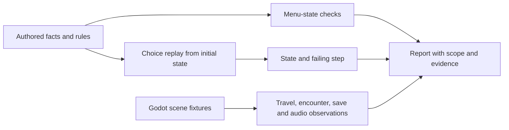

# Build a playable game, then explain it

Date: 2026-10-26. Audience: teaching collaborators and course designers. Status: **proposed teaching and research module**, supported by a working Lantern Quay demo and continuity checks. It has not been taught or evaluated with students. See the [research notice](NOTICE.md).

## Research summary

Begin with a short, agent-assisted game project: students describe a small world, direct an agent, play the result, and request revisions. Then use the game they made to teach the engineering beneath it: state machines, testing, geometric transforms, mesh production, skeletal animation, resource budgets and reproducible builds. The research question is whether early ownership of a playable artifact improves engagement and later engineering understanding without leaving students dependent on the agent.

The first project should require little manual implementation. Students still own the brief, design decisions and acceptance of the result. Later lessons progressively require them to predict, inspect, change and explain the system themselves.

## Contents

- [Teaching context and evidence](#teaching-context-and-evidence)
- [First project](#first-project-a-short-playable-chapter)
- [Focused lessons](#focused-lessons-after-the-first-demo)
- [Assessment](#assessment)
- [Research pilot](#research-pilot)
- [Engine requirements](#engine-requirements-and-current-status)
- [Teaching evidence](#teaching-evidence)
- [Limitations and sources](#limitations-and-search-methodology)

## Teaching context and evidence

1. **There is local precedent for mentored AI projects.** Purdue's AI Forge describes teams taking ideas to prototypes with faculty and industry guidance. Its project course has prior AI-study requirements. The proposed Oathshaper module would start with a simpler, supplied game template and introductory programming prerequisites; it should not be represented as a replacement for AI Forge. [AI Forge](https://cs.purdue.edu/academic-programs/ai-forge/aiforge.html), accessed 2026-10-26.
2. **The engineering connection is broader than prompting.** Purdue Engineering's Think AI initiative connects practical use with technical understanding and responsible application. Oathshaper can provide an inspectable system in which students move from using an agent to understanding the artifacts it produces. This is a design inference, not evidence that the proposed teaching sequence works. [Think AI](https://engineering.purdue.edu/ai_initiatives), accessed 2026-10-26.
3. **A finished artifact needs critique and reflection around it.** PBLWorks' project-design framework includes student choice, inquiry, reflection, critique and revision, and a product for an audience. Those elements support a peer-playtest cycle and an explanation of changes, beyond simply submitting a generated game. The framework is guidance, not a controlled evaluation of this module. [PBLWorks project design](https://www.pblworks.org/gold-standard/pbl-project-design), accessed 2026-10-26.
4. **AI confidence is not demonstrated competence.** Dickey and colleagues' AI-Lab study used orientation, critique of model outputs and reflection across several courses. Its revised report describes changes in self-reported comfort and use, plus focus-group accounts. It does not establish improved independent programming performance. That distinction motivates an individual transfer task in this pilot. [AI-Lab, v2, 16 July 2026](https://arxiv.org/html/2505.00100v2).
5. **Independence needs instruction.** EEF recommends explicitly teaching planning, monitoring and evaluation, with modelling and guided practice before independent use. Its cited population is ages 16–19, so applying this to undergraduate game engineering is a hypothesis. It argues against assuming students will discover sound verification habits simply because an agent built something impressive. [EEF guidance, 24 August 2026](https://educationendowmentfoundation.org.uk/16-19/developing-independent-learners/metacognition-and-self-regulation).

## First project: a short playable chapter

Proposed setting: the opening two weeks of a larger undergraduate laboratory or project course. Teams of two or three have introductory programming experience; prior Rust, Godot, modelling and rigging knowledge is not required for the first exercise. The instructor provides a tested template, an agent environment and reusable assets. Setup time is measured separately from learning tasks.

**Student brief:** “Use an agent to build a five-to-eight-minute game demo comparable in scope to Lantern Quay. Give the player a clear problem, a reason to visit an interior, a decision that changes something, one companion interaction, one encounter, and a visible resolution. You choose the setting, characters and story.”

Proposed limits keep the exercise finishable: one small locale, three speaking characters, one interior, one consequential optional choice, one encounter, one ending and a save point. Begin with block meshes or supplied art. New generated meshes are optional, subject to a common class budget. Visual spending should not determine grades.

### What students do

1. Write a one-page brief: what the player wants, who helps or obstructs them, and what changes at the end.
2. Direct the agent to make a blockout, dialogue and playable route. Approve the proposed changes and play them.
3. Exchange builds with another team. Record a short playthrough, narrating confusion, surprises and requested changes. Written feedback is an equivalent option.
4. Ask the agent to propose revisions. Choose which to accept, rerun continuity checks and compare the builds.
5. Submit the playable demo, a short design-decision log, the check report and one known limitation. Include one example where the student rejected or corrected the agent.

The first demonstration should preserve the pleasure of making a game. A short instructor orientation establishes how to revert a change, read a failed check, manage tool access and avoid spending surprises. Detailed lectures about the full pipeline follow the first playable result.

### First-project acceptance

- A peer can state the player's objective after the introduction.
- The required route can reach its ending; the optional choice does not unintentionally prevent completion.
- World state, dialogue and reward agree at the save point and after loading.
- The team can show one revision driven by observed play, with before/after evidence.
- The team identifies what was generated, reused and personally changed.

These checks assess a bounded first artifact. They do not by themselves demonstrate each student's technical mastery.

## Focused lessons after the first demo

Each lesson begins with something the class has already seen in its own games, then exposes one part of the implementation. A proposed six-lab sequence can be extended into a semester project.

| Lesson | Start with the game | Underlying engineering | Individual evidence |
|---|---|---|---|
| 1. Continuity | A character asks why a lit tower is dark | Boolean predicates, state transitions, invariants, test oracles, counterexamples | Predict the failure; trace the action sequence; fix applicability; explain what the checker cannot prove |
| 2. Worldbuilding | A wider building moves its doorway away from the path | Coordinates, transforms, scene graphs, collision, projection and common scene contracts | Repair a doorway fit and show why both the mesh and collision agree |
| 3. Mesh production | A beautiful generated model runs slowly or has the wrong scale | Topology, texture coordinates, material maps, decimation, level of detail and resource measurement | Compare visual output and measured geometry/resource cost before and after a change |
| 4. Skeletons and equipment | A companion walks backward or a sword leaves the hand | Bone hierarchy, weights, local/global transforms, attachment sockets and inverse kinematics | Repair one attachment or orientation and explain the transform chain |
| 5. Dialogue and audio | A revised line plays an old recording or skips its reply | Stable identity, asset invalidation, event ordering, cancellation and timing | Make a line change; prove the intended recording and state transition occur once |
| 6. Integration | A revision breaks another route or an older save | Contracts, dependency changes, regression selection, serialization and reproducible builds | Diagnose an unfamiliar seeded defect and make a narrowly scoped repair |

The continuity lesson has a [runnable exercise](../tutorials/continuity-lab.md) using current Lantern Quay data. A second [dialogue repetition exercise](../dialogue-script-checker.md) introduces graph traversal, state equivalence and heuristic false positives: students compare an accidental echoed response with an intentional acknowledgment and inspect the witness path. Worldbuilder and mesh lessons build on [the storyboard specification](008-playable-storyboard-content-pipeline.md); the unified creator UI remains proposed.

### Make the checker explainable

Show students the three different questions it answers:

A matrix explores combinations, including impossible ones. An authored replay shows that choices produce a state under its entry assumptions. A Godot fixture checks selected host behavior. None automatically proves an understandable story, attractive camera shot or every possible player route. Students should learn to challenge an incorrect rule as well as fix incorrect game code.

## Assessment

Proposed module rubric: 20% playable brief and coherent scope, 20% playtest-driven revisions, 25% evidence and debugging, 25% individual explanation and transfer, 10% reproducibility and asset/tool records. The rubric is a proposal for pilot review, not an adopted institutional grading policy.

Require a short individual explanation: predict what a rule will report, locate the relevant state transition or transform, and explain a failure the agent missed. Include a small unfamiliar transfer task completed without an agent, with documentation available. The task should assess taught concepts rather than memorized APIs. Pair work is welcome, but a team's polished build cannot substitute for each student's explanation.

Grade honest limitations and effective rejection of bad advice. Do not award points for prompt volume, generation expense or a green report with no understanding. Allow text-based review and alternative input methods, and provide a campus/local option so personal subscriptions or high-end hardware are not prerequisites.

## Research pilot

Primary questions:

- Does beginning with an agent-assisted playable artifact improve completion and engagement compared with a scaffolded template project using conventional tools?
- After focused lessons, can students independently explain and repair the systems they initially delegated?
- Does continuity automation reduce verification time without raising missed-defect rates or instructor support load?

For a small feasibility pilot, collect observations without causal claims. For a later comparative study, use equivalent briefs and budgets, record prior programming/game experience, and counterbalance task order or compare matched sections. Give both groups access to the learning materials; distinguish instruction effects from novelty, model quality and time spent on art. A defensible sample size requires an assessment plan and power analysis, not an invented enrollment target.

Measure time to first playable build, revisions accepted after peer feedback, continuity setup/triage/recheck minutes, false alarms, missed seeded defects, requests for instructor help, individual concept scores and delayed transfer. Record cost, latency and setup failures separately. Keep naturally occurring bugs separate from seeded defects. Self-reported enjoyment is useful but must not replace observed behavior or independent assessment.

The earlier **60–70% manual continuity-work reduction** remains an unmeasured target. Test it using [the continuity pilot denominator](010-continuity-checking-pipeline.md), including rule maintenance and false-alarm review. Do not present it as a learning gain or a reduction in total development time.

If classroom data will support publishable human-subject research, settle institutional review and voluntary participation before collection. Research participation should not affect grades. Retain only the necessary student evidence, with an instructor-approved storage and consent plan.

## Engine requirements and current status

| Capability | Current evidence | Needed for a classroom kit |
|---|---|---|
| Small playable chapter | Lantern Quay, interior, companions, encounter and ending | Generalize chapter-specific IDs and authoring paths; supply a tested starter brief |
| Continuity pipeline | Independent Rust rules/replays, Godot observations and one report command | Editor-facing explanations, broader authorable contracts, accessible replay navigation |
| World and asset pipeline | Imported tower/garden, rigging tools, equipment sockets and source records | Integrated storyboard/blockout tools; consistent scene contracts and low-cost asset kits |
| Agent workflow | Repository can be changed through the current coding-agent workflow | Versioned classroom instructions, bounded tasks, review/revert controls and equivalent access |
| Evaluation | Automated local engineering checks | Student pilot, independent assessments, support-cost data and target-hardware trials |

No partnership with Purdue, Meshy or another provider is established by this proposal. Public distribution and asset licensing decisions remain separate from the teaching design. Provide reusable or locally generated assets as a baseline, and treat a future provider partnership as an optional improvement.

## Teaching evidence

A teaching review packet should include the playable demo, current check report, one failing/passing example, the lab handout and the proposed assessment design. These demonstrate engineering practice and a testable teaching idea; they do not establish teaching outcomes or institutional partnerships.

## Limitations and search methodology

Focused research: five primary or official sources linked inline, accessed 2026-10-26. Queries for the teaching sources covered experiential/AI teaching, project-based learning design, scaffolded GenAI instruction and explicit metacognitive teaching. The revised AI-Lab abstract and relevant full-text sections were checked; its self-report scope was preserved. EEF's population differs from the proposed undergraduates. No consulted source directly evaluates this agent-first game-design sequence.

Next design review should settle course placement, contact hours, prerequisites, accessibility accommodations and institutional tool access. These are classroom deployment choices; they do not block running the checker on the current game or documenting the proposal.

Related: [continuity pipeline](010-continuity-checking-pipeline.md), [storyboard pipeline](008-playable-storyboard-content-pipeline.md), [pose and rigging research](004-pose-guided-character-animation.md), [current run](../continuity-runs/20261026-current/README.md).
