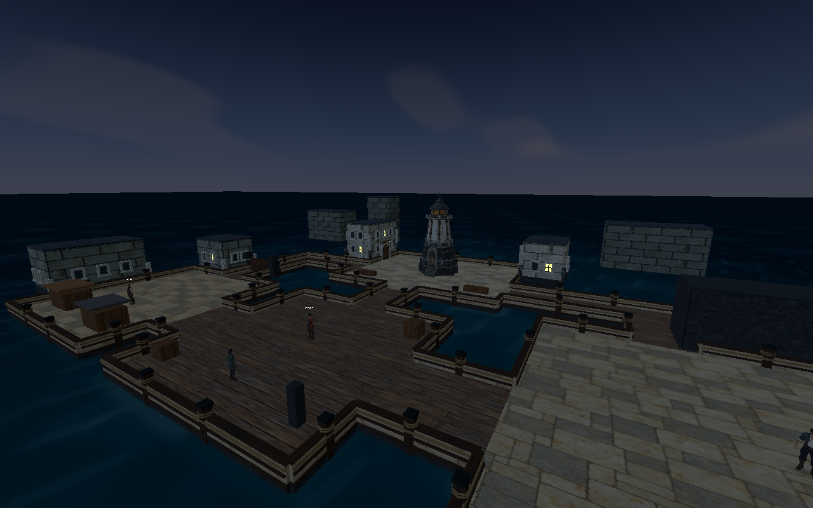
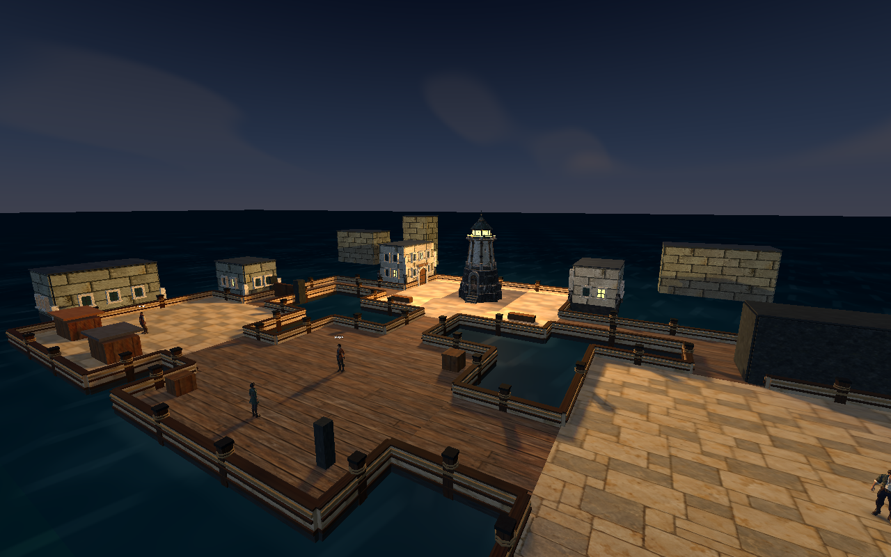

# The Quay Robbery — source acceptance, 2026-10-25

The author's final approved route is implemented in story revision 7. Start a new journey; incompatible older story saves are rejected without overwriting them. This source revision has not been repackaged into the earlier release archives.

## Playable route

1. Mara hears a crash while the tower is dark. The opening points to the office.
2. The clerk is inside, beside the forced-open payroll chest. She identifies the Crimson Raider, his two mechanical guards, and the stolen wages.
3. Tell Mara and recruit her. She walks to the garden gate.
4. Ivo has cornered the thief. He opens the gate once Mara joins; oil, morality and optional history are not prerequisites.
5. Fight the raider and guards. Command deploys Mara and Ivo; Vanguard also uses Ivo, leaving the clerk in her office. Flow retains its one-follower combat rules.
6. Search the defeated raider on the clear central path. The payroll pouch enters quest inventory. Victory alone does not complete the robbery quest.
7. Return the pouch to the clerk. Coins appear in the office chest, the wages are paid, and the tower is lit.
8. A skippable closing shot shows the tower and quay. An alternate line acknowledges oil donated earlier.

## Lighting evidence

The dusk ambient fill remains constant. The tower's amber panes emit light when lit, and four shadowed lights at its lantern windows illuminate the quay and building facades. The source was moved out of the roof to the measured lantern band. Mara's personal OmniLight energy is zero.

At an unchanged 1280×800 camera and exposure, the sampled lower scene's luminance sum rose from 926.12 to 1528.28 (1.65×). This is a rendered visibility check, not a physical photometry claim. Interior wall lamps remain independent.

| Tower out | Tower lit |
| --- | --- |
|  |  |

[Lantern close view](tower-lit.png) · [Ransacked office](ransacked-office.png) · [Raider search view](raider-payroll.png)

## Verification

- Rust workspace: 120 tests including the documentation test passed. The repaired XP/currency reward receipt was checked again with the deterministic encounter test; it does not grant a quest seal or the payroll pouch.
- Formatting and strict workspace Clippy passed; the native extension was rebuilt.
- All 23 Godot suites configured in `scripts/check.sh` passed after repairs; see [individual gate results](godot-gates.json). The sequence was resumed at the failed tests after fixing stale story expectations, rather than reported as one uninterrupted script run.
- The complete Command campaign route passed 218 checks in headless and native rendered runs. It covers office entry, recruitment and routes, earned victory, separate looting/return states, closing presentation and save/load.
- The tower render gate passed six checks including actual image brightness comparison; the headless variant checks state and persistence.
- Native recorded-voice playback passed 86 checks, including natural player-to-NPC completion and sequential chapter speech.
- All 72 production voice clips have matching displayed/spoken text identities, file hashes and objective PCM QC. The Crimson Raider uses the already auditioned CC0 voice-donation embedding also used for the vendor. The provider, seed revisions and attribution remain in the production provenance manifest.
- Godot's headless dummy renderer still emits its existing `mesh_get_surface_count` null-mesh shutdown diagnostics. Native rendered story and lighting runs passed. No physical controller, Steam Deck, Intel runtime, new release package or human voice-performance acceptance is claimed here.

## Editorial review

Actual Humanizer routing, the earlier fiction critic, Obelus, and the local semantic audit are recorded in [review.md](review.md). The final author revision resolves the geography, motivation, reward and visible-ending findings. The remaining lexical and branch-repetition flags are documented intentional keeps. Tool scores are not evidence of reader comprehension.
